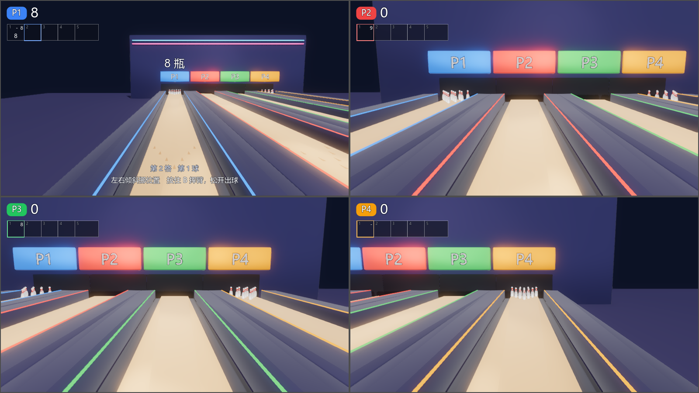
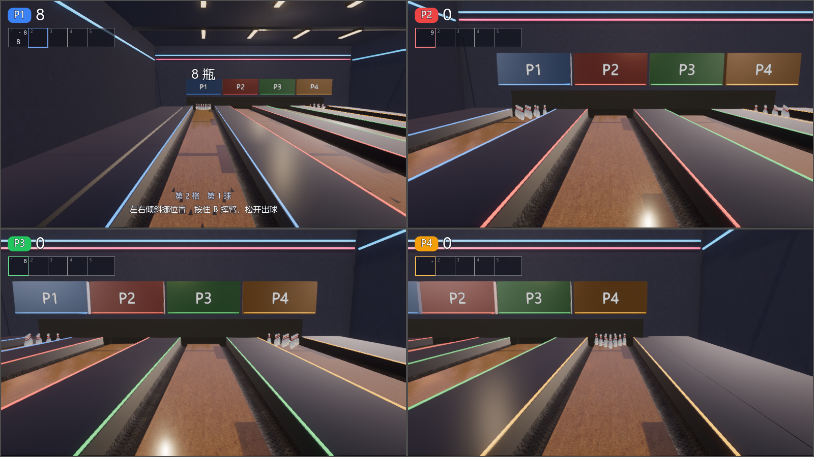
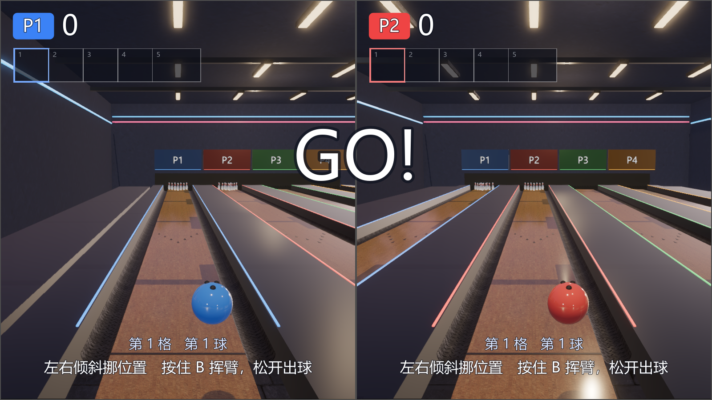
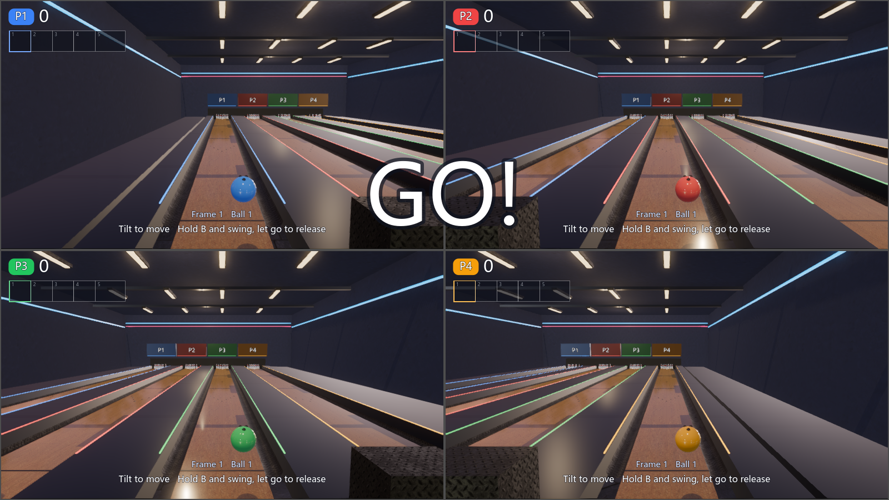
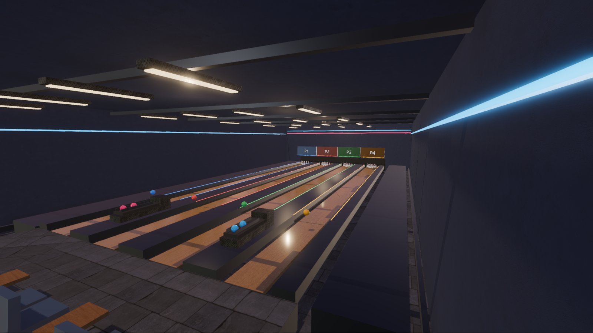

# 保龄球 B1：场馆与材质

本切片范围限于 #25 的 B1：保留霓虹夜场调性，将保龄球场馆从纯色几何升级为有木球道、沟槽、瓶区遮罩、回球机、座位、天花和灯具的室内场景。B2 人物、B3 开场 / 回放、B4 音效 / 领奖台、B5 新地图和项目收尾仍未完成。

## 设计边界

- `RSBowlingHall` 在场景加载时一次建立视觉几何、缓存材质和重复构件的 MultiMesh；游戏脚本继续持有原有碰撞体与玩法。
- 球道长度 / 宽度、沟槽、隔板、瓶区碰撞体、物理材质、球瓶质量和形状均沿用原值。新回球设施、座位和灯具只有视觉，不增加碰撞。
- 复用已登记的 `plywood`、`metal_plate`、`painted_plaster_wall`、`large_grey_tiles` 和 `rooftop_night`；不新增外部素材或依赖。球道专用 shader 用扫描纹理、纵向板缝与沿球道变化的油面粗糙度；球瓶为漆面、红色颈圈，球为抛光树脂。
- HDRI 只作室内环境和反射源，实体墙与天花围合场馆；照明经 `RSSettings.environment` 和 `RSSettings.sun_shadows` 应用画质设置。
- 不改公共框架、HUD / 菜单、已有共享 shader、其他运动代码或素材；不依赖尚未合入的界面改版。

## 验收

1. 独立 headless 检查尺寸、米制 UV、PBR 资源、原有碰撞布局、2 / 4 人的球瓶与计分回归，以及暂停 / 重开 / 场景释放时节点和材质复用。
2. 项目规范、i18n、工具 / 中枢测试、素材同步校验、发布 / 隐私扫描和游戏无界面启动通过。
3. 在隔离隐藏桌面实际运行 2 / 4 人演示，检查 1600×900 中英文截图与前后对照；同机同设置测量帧率。无头通过不代表画面通过。
4. 真实手柄、BLE、HDR、VRR、跨平台和手感不在本次自动验证范围。

专用工具为 `python tools/test_bowling_environment.py --godot <Godot>`；隐藏桌面图形验收使用 `--screenshots`，有多块显卡时可额外传 `--gpu-index <编号>`，它是引擎 flag，不是项目参数。默认不指定显卡。正式性能验收仍依赖 #22 的 benchmark；有限暖机和单次短采样只能作为同机前后对照，不能替代完整性能序列。

## 验证记录

已通过的检查：

- Godot 4.7.2 官方版无头导入；新增脚本和 shader 的资源 UID 已保留。
- `check_conventions.py`：0 错误，3 个既有 SIZE 警告；`i18n_check.py`：392 条，0 缺失 / 多余。
- 工具测试 58 项及 79 个子测试；中枢测试 62 项；Node 素材同步测试 8 项。
- `sync_assets.mjs --check`：222 个锁定文件全部通过；`publication_audit.mjs --strict`：0 发现，0 待补许可；运行时素材与下载量不增加，新增验收截图已登记许可。
- 新 Python 工具的 Ruff 和 `git diff --check` 通过。
- `test_bowling_environment.py`：双人 / 四人 × 中英文，1072 项检查，0 失败 / 引擎错误；覆盖完整碰撞布局、球瓶物理参数、米制 UV、扫描纹理 / HDRI、画质开关、玩家四色、计分、暂停、重开和释放。
- `smoke_test.py --games bowling --all-maps --players 2` 和 `--players 4`：原有单张地图的完整五格机器人回合都进入成绩阶段。
- `smoke_game.py`：菜单和全部项目的 15 项启动通过；旧限帧退出仍有已有资源保留提示，保龄球项没有该提示。
- `test_game.py --party`：外壳、62 项存档检查、存档重开及飞机 → 射箭 → 保龄球派对赛通过。
- `test_solo.py`：六项目地图 1 × 三难度的 18 场正式单人回归全部通过，包含保龄球三个难度。
- `test_bowling_environment.py --screenshots --gpu-index 1`：真实 780M、1600×900、中画质（quality=1），双人 / 四人 × 中英文，共 1080 项检查，0 失败 / 引擎错误；输出 8 张截图，检查了玩家视口、双语 HUD、场馆设施与场景释放。

GPU 截图已审查通过。以下单次短采样已完成，但正式性能验收仍待 #22 的 benchmark 工具合入；本切片保持 draft，不能将 #25 整体标为完成。

## 同机短采样

改动前提交 `ac4a3ec01abcf05db82a13294ce960ec3b9aad7a`，改动后运行时提交 `737232ee328486d514623bcedf176f95b87dfa30`。Godot `4.7.2.stable.official.ed1daf0bf`、Forward+ / Vulkan 1.4.349、AMD Radeon 780M、原生 1600×900、高画质（quality=2）、upscale=0、max_fps=0、VSync 关闭；隐藏桌面运行，采样期间交流电状态均为 1。每组只预热 5 秒、测量 10 秒，按实际 `frame_post_draw` 间隔计算；每组仅一次，未进行正式 benchmark 的完整序列。[四份未修改的原始样本与算法](benchmarks/bowling-b1/README.md)保留全部有效间隔。

| 分屏 | 改动前平均 FPS | 改动后平均 FPS | 样本平均差 | 改动前 1% low | 改动后 1% low |
|---|---:|---:|---:|---:|---:|
| 双人 | 133.49 | 113.26 | -15.15% | 114.91 | 94.48 |
| 四人 | 101.03 | 94.05 | -6.91% | 88.92 | 74.63 |

这些数字只提供相同设备和设置下的有限前后对照，不代表正式帧率门槛已通过。后台负载未严格控制；改动前双人采样时，工具测试尾声 / 清理可能仍在同机运行。因此不能将上述差值全部归因于 B1，也不能据此确定稳定的性能回归。CPU / GPU 整帧指标为 `null`，没有单独归因；没有多次重复、完整回合、长期稳态、其他显卡、HDR / VRR 或跨平台测量。`tools/bench.py` 在此基线上尚不存在，正式性能验证继续依赖 #22。

## 原生画面与来源

以下五张 PNG 均原样保留，没有裁剪、后期或合成。四人前后对照来自上述高画质（quality=2）短采样；其余三张来自中画质（quality=1）的双语验收，不能将两组视为相同设置下的画质对比。

截图来自项目 MIT 代码 / 程序几何 / 现有 HUD，以及已登记的 Poly Haven CC0 素材；使用隔离的合成玩家，不含真实手柄、设备或玩家数据。联合画面登记为 MIT AND CC0-1.0，来源沿用 [THIRD_PARTY.md](THIRD_PARTY.md) 与素材目录的作者记录，没有引入新的外部素材。
