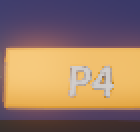
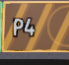
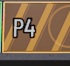
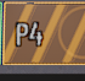

# B1 画面返工：PR #31 评论 6377607695

本轮继续 B1 场馆画面，并接入审查明确要求的公共开场镜头。人物、回放、音效、领奖台和新地图仍未实现；球道碰撞、刚体参数、输入、机器人和计分不变。

最新进展：当前样式的六次正式性能基线已有效完成并公开完整逐帧数据；125% 字号的中英文 2/4 人四例通过。运动原生项因运行后进程 guard 失败而保持 FAIL，另两档未运行，不能称运动验收通过。按用户要求先完成代码、稍后集中验收，本次仅补证据和说明，不再启动图形、性能或 smoke；PR 继续保持 draft/open。历史测试数字保留原版本含义，实际状态见文末。

## 最新画面调整

按用户随后指定的样式，移除 P1–P4 文字后独立的黑色底板，保留 MSDF、不透明预通过和深描边。保龄球五/十格计分板单独使用参考色 `#E3E5EF`、76% 不透明度，数字改用公共深色 `RSUi.INK`，让浅底上的投球标记、累计分和格号仍可读；公共玩家分数牌及框架主题不改。此前有黑底板的图只保留作历史对照，不能代替本次调整的最终图。

此样式的官方 4.7.2 场馆矩阵八例重新通过，共 4800 项、0 失败。首次测试仍按旧深色背景识别绘制单元，因观察器未更新而报告 4 项格数失败；保留该日志后，将观察器更新为实际的新背景标记，未减少原有格数、字体边界或玩法断言，八例完整重跑通过。该阶段之后的真实画面与正式基线另按文末记录。

## 标牌返工范围（评论 6380640451）

该轮原方案仅涉及 bowling 场馆、bowling 专用遮板 shader、对应场馆测试和本说明：从公共标签字体复制独立的 3D MSDF 字体资源，不修改共享字体或导入设置；标牌使用不透明预通过与描边，原方案的深色底板已按后续样式要求移除。图案用屏幕导数过滤细线并降低 emission，环境 bloom 设为零，glow 继续服从公共画质设置。验收包含同机位四人 2560×1440 原生 / FSR 原生抗锯齿 / FSR 质量截图与 200% 标牌裁剪，以及 2560×1080 的 1/2/4 人实际画面；当前静态证据与六次正式性能基线见文末，运动验收仍未通过且未齐，继续保持 draft。

实现后的官方 4.7.2 headless 场馆矩阵已跑 2/4 人 × 中英文 × 100%/125%，八例共 4768 项检查、0 失败；覆盖独立 MSDF 字体源、间距、不透明预通过、描边和四块深底板，以及原有规则 / 碰撞 / HUD 回归。规范 0 错误、文案 0 缺失 / 0 多余。该结果尚不验证 GPU shader、标牌可读性或运动闪烁；截图和正式测量仍待完成。

独立复核随后发现 MSDF 距离范围 16 不足以覆盖 10 像素描边；按 [FontFile 官方约束](https://docs.godotengine.org/en/stable/classes/class_fontfile.html#class-fontfile-property-msdf-pixel-range)改为 24，并增加范围至少为描边两倍的断言。范围 16 的截图单独保留，不能代替该修正后的画面验收。

修正后八组矩阵重新运行，共 4800 项检查、0 失败。范围 16 的上一版本另跑公共启动 15 组通过（仓库既有退出缓存诊断仍按原工具规则排除）；范围 24 仅改字体参数和对应断言，不将旧版画面或旧版全量测试写成最新版结果。

## 参考与取舍

仅通过官网查看参考，不下载、不将参考图片放入仓库，不复制品牌标志或原作图案：

- [All Star Lanes Brick Lane，官方场馆图册第 8 页](https://www.allstarlanes.co.uk/wp-content/uploads/2025/01/Venue-Hire_Full-brochure.pdf)：休息区、软包座位、桌面与远处球道形成前中后景。应用为有圆边的座椅、圆桌、回球设备，避免空场和方块占位。
- [All Star Lanes The Loft，官方图册第 4 页](https://www.allstarlanes.co.uk/wp-content/uploads/2025/01/The-Loft_STRD_brochure-final.pdf)：球道尽头的亮色几何与霓虹标识形成视觉焦点，低照度空间保留暖色局部灯光。应用为原创几何图案遮板、灯框与独立打光，不复刻品牌文字。

## 实装方向

- 提亮现有锁定的扫描灰泥、砖墙、地砖、木饰面；墙面增加砖裙墙、木饰条、踢脚灯带和几何灯箱，天花增加成组吸音构件与格栅。
- 使用真正的聚光灯在球道形成光池，瓶区单独打光；发光灯具采用有厚度和圆边的灯壳，霓虹继续使用 emission / glow 并遵守画质设置。
- 遮板采用新增的原创 MIT 程序图案 shader [`game/shaders/bowling_mask.gdshader`](../game/shaders/bowling_mask.gdshader)、玩家四色灯框和 `RSUi.font_label()`，不新增外部贴图。该 shader 仅由 bowling 引用，共享 shader 不变。
- 复用程序倒角网格构建软包座椅、圆桌与回球设备，重复部件使用 MultiMesh；球道箭头和引导点加强对比。
- 自绘计分格使用 `RSUi` 色值、数字字体和方角 `draw_box`。计分板随字号整体扩大，10 格时按分屏宽度限制布局，保持数字与格子的比例。开场只通过 `RSIntro` 与 `draw_title_card` 接入原倒数阶段，常规玩法相机锚点保留。

## Headless 验证

以下为早期 headless 阶段的历史记录：使用官方 `4.7.2.stable.official.ed1daf0bf`，隔离临时数据和 `RS_TEST_MODE=1`；当时尚未进行后文的真实渲染、截图和正式测量。数字不作为本次文档提交的新运行结果：

| 检查 | 结果 |
|---|---|
| `tools/import_game.py --godot <official-4.7.2>` | 首轮通过；新 shader UID 由引擎生成。47 个无关导入描述符仅新增官方默认字段，核对后恢复 |
| `tools/test_bowling_environment.py --godot <official-4.7.2>` | 2/4 人 × 中/英文 × 100%/125%，默认 quality=2，八例 4656 项检查、0 失败、0 引擎错误 |
| `tools/smoke_test.py --games bowling --players 2` / `--players 4` | 两场完整机器人回合均通过 |
| `tools/test_lifecycle.py --games bowling --players 2 4 --languages zh en` | 四例合计 108 项检查通过；合成控制器入场、暂停、重开、断连 / 重连及返回菜单 |
| `tools/test_game.py --party` | shell、存档 62 项及重新打开、三项目派对流程通过；存档故障注入的预期报错仍按原工具分类 |
| `tools/smoke_game.py <official-4.7.2> --project game` | 15 个公共启动案例通过；原工具已明确排除的其他项目退出缓存资源诊断保留在日志中 |
| 规范 / 文案 / Ruff | 0 错误；规范仅有既有滑板 / 滑雪 SIZE 警告，文案 0 缺失 / 0 多余 |
| 工具 / 中枢 / Node 测试 | 71 项及 130 个子测试 / 62 项 / 8 项通过 |
| 素材校验 / 隐私检查 | 222 个现有锁定文件校验通过，下载 0；隐私扫描 0 发现 |

专用 suite 保留缺 HDRI fallback、碰撞布局 / 摩擦 / 质量、计分、四色与光源配置检查；新增开场各段端点、暂停、重开、原瞄准 / 跟球机位与 FOV，以及两种镜头晃动设置下无额外抖动的断言。实际 HUD 绘制记录覆盖 5/10 格满分、末格三次投球标记和中文 fallback。首轮实测发现 10 格布局越出双人视口，随后 125% 字体度量发现文字越出格顶；失败日志与边界保留，修复整个网格的缩放与限宽后八例重跑通过。

headless 不验证灯光观感、shader 实际渲染、字体视觉可读性或 GPU 开销。历史 B1 截图与旧短采样不能作为本轮画面验收。

## 集中验收仍待完成

1. 同机位四人 QHD 与宽屏代表图已作静态审查；125% 中英文 2/4 人四例及代表原图见文末。它们是受控 intro/首个 PLAY 观察，不能代替普通完整流程；最新自然流程、最终开场与运动闪烁 / 拖影仍留待集中验收。
2. `tools/bench.py --games bowling --players 2 4 --quality 2 --repeat 3` 对当前样式的六次正式基线已完成。它没有匹配的旧样式正式对照，不能据此声称样式性能收益；完整数据与限制见下文。
3. 运动原生项保持 FAIL，FSR 原生抗锯齿 / FSR 质量两项未运行；停止后没有自动重试或继续 flow/smoke。用户要求先完成代码、稍后集中验收，后续图形、性能与必要功能检查在统一安排后进行。本轮仍是 B1，不关闭整个 #25。

## 2026-10-24 最终样式的静态画面证据

最新画面对应 `fb3af56008647e82a7b34598a687358e0ead8f5a`：P1–P4 标牌移除独立黑色底板，保留专用 MSDF 字体（pixel range 24、size 128）、10 像素深色描边和 opaque prepass；遮板细线使用 `fwidth` 过滤，环境 bloom 为 0，glow 仍服从公共画质设置。保龄球计分格采用取色值 `#E3E5EF`、alpha 0.76（76% 不透明度），格内数字使用深色 `RSUi.INK`。

以下六张为未经缩放、重编码或合成的原始 PNG；文件哈希、源码与 fixture/pose 标识、官方引擎、实际 GPU、输出和玩家视口、AA/scale 及对象比较记录见 [visuals.json](benchmarks/bowling-b1-revision/visuals.json)。旧场馆原生参考来自 `cf889669aa515790d2d8ab6b77a354c55afa3fb6`。截图内容使用合成 P1–P4。

| 画面 | 配置与用途 | 原始 PNG |
|---|---|---|
| 旧场馆四人参考 | 2560×1440，quality=2，原生，Radeon 780M | [旧场馆原生](screenshots/bowling-b1-r2-before-qhd-native.png) |
| 最终样式四人 | 2560×1440，quality=2，原生，Radeon 780M | [最新原生](screenshots/bowling-b1-r2-after-qhd-native.png) |
| 最终样式四人 | 2560×1440，quality=2，FSR 原生抗锯齿，scale=1.00，Radeon 780M | [FSR 原生抗锯齿](screenshots/bowling-b1-r2-after-qhd-fsr-native-aa.png) |
| 最终样式四人 | 2560×1440，quality=2，FSR 质量，scale≈0.67，Radeon 780M | [FSR 质量](screenshots/bowling-b1-r2-after-qhd-fsr-quality.png) |
| 最终样式中文双人 | 2560×1080，quality=2，原生，GeForce RTX 4060 Laptop GPU | [宽屏双人 PLAY](screenshots/bowling-b1-r2-after-wide-2p-zh-play.png) |
| 最终样式英文四人 | 2560×1080，quality=2，原生，GeForce RTX 4060 Laptop GPU | [宽屏四人 PLAY](screenshots/bowling-b1-r2-after-wide-4p-en-play.png) |

四份 QHD 使用同一冻结首个 PLAY 夹具：P1 为 AIM，P2–P4 为布置在瓶区前方的跟球观察机位，FOV 均为 50；保留真实 HUD、隐藏共享 GO，44 个刚体冻结。旧/新原生的 fixture 与 pose 哈希、实际相机、root viewport 及全部 44 个冻结对象相同，相机与物体变换的最大数值差均为 0。最新三档也保持相机姿态、投影、分屏布局与冻结对象相同，AA 和渲染 scale 按档位变化。这是固定静态观察画面，不是自然玩法重放。

宽屏图来自独立的普通 demo PLAY 夹具，用于检查双人/四人布局。实际 PNG readback 为 2560×1080；内容基准为 1600×900，展开后的 root 逻辑可见区域为 2133×900，玩家实际视口分别为 1062×896（双人）和 1062×446（四人）。Godot 的 root ViewportTexture advertised size 单独保留在元数据，不替代实际 PNG readback。宽屏与 QHD 的 GPU、夹具和布局不同，不能用于同条件性能作差。

### P1 远望 P4 的 200% 裁剪

以下均为上表原图中同一源像素框 `[858,252,928,318]`（左/上包含，右/下不包含），70×66 像素以最近邻放大 2 倍为 140×132。它们是已披露的裁剪放大图，不是原始尺寸截图；源图与裁剪 SHA256、框坐标和缩放 provenance 均记入 `visuals.json`。

| 旧场馆原生参考 | 最新原生 | 最新 FSR 原生抗锯齿 | 最新 FSR 质量 |
|---|---|---|---|
|  |  |  |  |

### 静态观察与边界

主任务已逐张查看最新三档 QHD、宽屏双人/四人原图及以上四份 200% 远 P4 裁剪：标牌在这些静止画面中可辨，没有观察到新增布局越界；浅色半透明计分格下仍可见场景。这个结论仅覆盖这些画面和机位。运动闪烁、拖影、真实手柄手感、正式性能、HDR/VRR 与跨平台行为未由此图包验证；没有以截图或冻结夹具声称帧率门槛通过。

新增截图沿用项目 MIT 代码/程序几何及既有已登记 CC0 素材的来源，联合画面登记为 **MIT AND CC0-1.0**；字体及其他既有资源记录见 [THIRD_PARTY.md](THIRD_PARTY.md)。本段补充当前静态证据，历史测试和短采样数字仍保留其原始版本含义，B1 之外的 #25 工作也不因此完成。

## 2026-10-24 正式性能基线（当前样式）

官方 Godot 4.7.2（ed1daf0bf）、AMD Radeon 780M、驱动 32.0.31019.2002、1600×900，quality=2，原生请求，VSync 关闭、帧率不限、HDR 关闭。2/4 人各 3 次，每次预热 10 秒、采样 30 秒，seed=20261023；6/6 有效、0 失败、0 重试。源码为 `0c71361f7f6b4f31aea4c0e217e53f70d4401b23`。

| 人数 | 合并帧数 | FPS | p95 ms | p99 ms | 1% low FPS | 最差帧 ms |
|---|---:|---:|---:|---:|---:|---:|
| 2 | 8010 | 88.98827 | 12.7375 | 13.4479 | 70.18961 | 26.372 |
| 4 | 6268 | 69.62846 | 16.52985 | 19.03656 | 47.08742 | 30.125 |

从三次逐帧样本合并计算，分位使用 R7，1% low 为最慢 ceil(1%) 帧耗时均值的倒数。[manifest](benchmarks/bowling-b1-formal-20261024/manifest.json) 登记六份完整公开 raw、原私有 raw 与公开导出各自的 SHA256；[stats](benchmarks/bowling-b1-formal-20261024/stats.json) 给出逐次统计和逐视口 GPU 均值/覆盖率。公开 raw 的逐帧键、数值类型、数值、null 与顺序完整保留，元数据经过白名单重写，并采用仓库规定的 LF 换行；公开 SHA256 对应实际提交文件字节。

逐视口 GPU 为 last-available render work，分别报告，不能相加成为整帧 GPU；整帧 GPU 未采集，保持 null。CPU TIME_PROCESS 是引擎处理时间。此 sampler 未采集逐玩家实际视口尺寸、AA 和 scale，相关字段为 null，不能用静态截图替代实测。源码、资产导入缓存和真实存档前后一致，无 records，隐藏 helper 持续 AC 监控通过。

这是当前样式的绝对基线。没有同条件旧样式正式测量，不能声称样式性能收益。Balanced、频率未锁、正常桌面可用，顺序为 2P 三次后 4P 三次，没有随机化。125% 受控静态四例的结果另见下节；完整运动与自然流程仍未验收。此六例不验证真机手感、HDR/VRR 或跨平台行为。

## 2026-10-24 125% 字号与运动验收实际状态

这一批仍锁定 `0c71361f7f6b4f31aea4c0e217e53f70d4401b23`，整个 game tree 与最终样式 `fb3af56008647e82a7b34598a687358e0ead8f5a` 相同。本次提交只增加文档和证据，未改运行时实现。官方 Godot 4.7.2、Radeon 780M、Forward+ / Vulkan；静态四例为 1600×900、quality=2、原生、125% 字号。

| 项目 | 实际结果 | 原图保留与边界 |
|---|---|---|
| 2P 中文 / 英文 125% | 各 PASS，477 项检查 | 各 intro/play/hall 三张原图 |
| 4P 中文 / 英文 125% | 各 PASS，735 项检查 | 各 intro/play/hall 三张原图 |
| 4P QHD 原生运动 | **FAIL**；worker/helper 的 120 连续帧、物理运动、时钟推进、引擎退出与隔离断言通过，launcher 的全机进程 guard 未通过 | 120 张原帧与真实时间遥测保留，未将此项改成 PASS |
| 4P QHD FSR 原生抗锯齿运动 | **NOT_RUN** | 首次失败后未启动 |
| 4P QHD FSR 质量运动 | **NOT_RUN** | 首次失败后未启动 |

合计 **4 PASS / 1 FAIL / 2 NOT_RUN，0 自动重试**。静态四例共 2424 项检查，0 引擎诊断；源码、fixture、真实存档和导入 cache 元数据前后一致，五根用户目录隔离、无 records、交流端点及 helper 每秒检查通过。全部 132 张原 PNG 和失败记录保留，公开包只取已审核的四张代表图；图像未经缩放、重编码或合成。[acceptance-20261024.json](benchmarks/bowling-b1-revision/acceptance-20261024.json) 白名单登记状态、实际耗时、来源/fixture/原图哈希、root/玩家 VP、AA/scale 与机位。

| 125% 代表原图 | 配置 |
|---|---|
| [中文双人 intro](screenshots/bowling-b1-r3-125-2p-zh-intro.png) | 受控倒数观察 |
| [英文双人首个 PLAY](screenshots/bowling-b1-r3-125-2p-en-play.png) | 源测试暂停游戏 process 后的 HUD 观察 |
| [中文四人 intro](screenshots/bowling-b1-r3-125-4p-zh-intro.png) | 受控倒数观察 |
| [英文四人首个 PLAY](screenshots/bowling-b1-r3-125-4p-en-play.png) | 源测试暂停游戏 process 后的 HUD 观察 |

主审已查看以上四张代表原图，未见新增边界越出。首个 PLAY 的时钟为 0，源测试暂停使中央 GO 覆盖层仍在，英文四人上排提示有少量被临时覆盖；这张受控样本不能判断普通游戏中是否存在持续遮挡，也不能替代完整自然流程。独立 hall 原图已保留；本批 intro 只是源 suite 的受控倒数时刻，不能声称完整开场视频已验收。

运动原生 worker 的实际耗时为 189.657 秒、hidden helper 为 191.735 秒，120 张 PNG 的读回与写盘会减慢运行，不能把采集速率当 FPS、自然玩法重放或跨 profile 匹配物理重放。该项失败原因是 launcher 在 worker/helper 返回后观察到两个 Godot 进程；原进程已在后续核对前退出，未取得其命令行和创建时间，归属未确认。后来看见的其他命令不能替代这两个原进程的身份证据。保留 **FAIL**，没有以 worker 通过重标整个 case，也没有继续另两档。

运动闪烁/拖影与三档完整比较仍未通过验收；最新普通 q2 双人/四人完整流程、必要 smoke 及最终主审在用户安排的集中验收中继续。旧版本的功能数字不冒充本批新结果。无黑底标牌、MSDF24 / opaque prepass / fwidth / bloom0 与 `#E3E5EF` alpha 0.76 样式保持。本批原图来源仍为项目 MIT 代码/程序几何和既有已登记 CC0 素材，联合画面登记 **MIT AND CC0-1.0**；不新增外部素材或依赖，PR 保持 draft/open。

本次文档/证据提交正常同步 dev `c6c0668fc09b882c621280da1014cacb6f30e691` 的字体许可打包修正，仅带入三个工具文件，game tree 保持 `139eb60678f581ad7b450dbc9ed2acca38e8bbbc`，与上述测量/采集来源相同。同步后的非图形检查：规范 0 错误、3 个既有 SIZE 提示；i18n 474 文本、0 缺失、0 多余；工具 pytest 73 项及 130 个子测试通过；中枢 pytest 62 项、Node 素材单元测试 8 项亦通过。隐私扫描 1211 文件、269 二进制资产，0 发现、0 权利未决；diff-check 通过。此阶段没有再启动 Godot、headless、图形采集或性能命令，提交后的最新 CI 与最终主审另行核对。

2026-10-25 后续正常合并 dev `d15083a`：包含已合入的 #65／#69 工具修复、#71 重连通知与 #72 hub 自行保持暂停输入，以及其他主线中枢／文档修复。保龄球实现不变，但公共 game tree 与测量源 `0c71361` 已不同；前述性能／图像仅归属于各自冻结来源，不能冒充这个整合版本的新测量。用户仍推迟本机集中引擎／画面验收，本次只做整合与非引擎检查。

## 2026-10-25 集中图形与自然流程观察进展

本轮冻结源码为 `5a0b91845f9971de606b1e2a2b758a919786b356`，使用官方 Godot 4.7.2、RTX 4060 Laptop GPU、quality=2。以下是实际执行与留存结果，尚未完成所有最终验收门。

| 观察 | 实际结果与范围 |
|---|---|
| 场馆图形 C：七组静态 | 全部 PASS，合计 3998 项检查；含 2560×1080 的 1/2/4 人，以及 1600×900 的 2/4 人 × 中英文 × 125% 字号 |
| 四人 QHD 连续运动 | C 原生、D FSR 原生抗锯齿和 D FSR 质量（scale 0.67）各完成 120 个连续真实渲染帧；原始 PNG、相机/视口/AA/scale 与时间遥测保留 |
| 自然观察 B：双人 | 普通机器人自然完成五格，经过大厅、倒数、PLAY 到 RESULTS；112 张原 PNG，观测状态 OBSERVED，实际耗时 247.734 秒 |
| 自然观察 C：四人 | 独立预算下自然完成五格到 RESULTS；112 张原 PNG，观测状态 OBSERVED，实际耗时 241.937 秒 |

宽屏自然观察的 2560×1080 是实际 PNG 输出，生产内容基准仍为 1600×900、`canvas_items/expand`；root 逻辑区域展开为 2133×900。双人内部视口为 1062×896，四人为 1062×446，不能按 1280×720 填报。root 纹理 advertised size 与实际 PNG readback 分开保留。

失败和后续补验保持各自状态：场馆图形 B 的 1200 帧等待在倒数 4.327889 秒时过早耗尽，未等到 6.8 秒开场结束，记录仍为 FAIL。`5a0b918` 只将源测试改为 20 秒真实时间等待，保留全部原检查条件，随后 C 的七组静态通过。C 的 FSR 原生抗锯齿首轮仍为 210 秒超时、仅 113/120 张原图；D 根据实际读回/写盘成本，将两档 FSR 的单组引擎预算改为 360 秒，分别在 219.203 / 209.860 秒完成全部 120 帧。没有降低帧数、拼接旧帧或自动重试，C 的超时与原未运行分支未被改写。

自然观察 B 共用 400 秒总预算，双人完成后四人仅获 139 秒引擎时限并超时，B 四人仍保留 FAILED。随后自然观察 C 为四人独占 400 秒预算，单次完成上述完整五格观察；没有覆盖旧失败，也未放宽阶段、运动或最终结果断言。

三档 120 帧序列采用受控相机路径、保持游戏和物理运行；自然观察使用生产相机与普通机器人。PNG 读回/写盘会增加运行开销，这些序列仅是画面和流程观察证据，不能换算 FPS、替代正式性能测试或声称跨档匹配物理重放。有效组的源码、fixture、存档及导入缓存元数据前后一致，未写玩家纪录。

主审已目视七组静态的代表PLAY帧、125%中英文四组PLAY，以及双人/四人的自然开场末段、首次出手和成绩帧；所查画面未见标牌新增光晕或计分板越界。也检查了三档运动的首/中/末部分原帧，仍不能据选帧推断全序列闪烁/拖影已排除。普通双人/四人回归和公共 smoke 已补齐，最终提交 CI 和完整运动目视仍待完成。这里不宣称 PR #31 已全部验收，更不代表整个 #25 完成；真实手柄/BLE、HDR/VRR 与跨平台行为仍未由这些观察验证。

### 本轮原图链接与后续补验更新

以下五张均来自冻结源码 `5a0b91845f9971de606b1e2a2b758a919786b356`，按原 PNG 字节复制，源/目标 SHA256 一致，没有裁剪、缩放、重编码或合成；来源/许可沿用项目既有 MIT 代码/程序几何及已登记 CC0 素材，联合画面为 **MIT AND CC0-1.0**。

| 原图 | 输出与取样 |
|---|---|
| [自然四人 frame_099](screenshots/bowling-b1-r4-natural-4p-frame099.png) | 2560×1080，原生，自然观察 C |
| [自然四人 frame_111](screenshots/bowling-b1-r4-natural-4p-frame111.png) | 2560×1080，原生，自然观察 C |
| [运动原生 frame-0060](screenshots/bowling-b1-r4-motion-native-frame060.png) | 2560×1440，场馆图形 C |
| [运动 FSR 原生抗锯齿 frame-0060](screenshots/bowling-b1-r4-motion-fsr-native-aa-frame060.png) | 2560×1440，scale=1.00，运动 D |
| [运动 FSR 质量 frame-0060](screenshots/bowling-b1-r4-motion-fsr-quality-frame060.png) | 2560×1440，scale=0.67，运动 D |

三档 `frame-0060` 是同一受控相机路径的同一索引，可对照取景；各次游戏/物理独立推进，球瓶状态未匹配，不能当作同一物理帧。这里的 QHD 输出仍使用生产 1600×900 内容基准，四人实际内部视口为 796×446，不能按 1280×720 填报。既有 r2 的 200% 裁剪仍只属于其旧冻结来源，未充作本轮新裁剪。

普通双人/四人回归实际 PASS，公共启动 smoke 实际通过 15 项。smoke 日志仍保留原 runner 明确排除的既有静态资源 shutdown 警告，不能据 PASS 声称无诊断。主审对照三张新 frame-0060 原图，FSR 质量档的远处小字仍明显较软；近景字清晰和静态检查通过，不能代替“P1看远处P4可读且不闪”的要求。完整序列的运动闪烁/拖影、远处文字可读性及最终提交 CI 仍是检查门，PR 保持 draft/open。本分支 Hub 仍为111项通过、5项legacy时钟测试失败；独立修复 #82 的116通过尚未合入，不能记成本分支通过。
