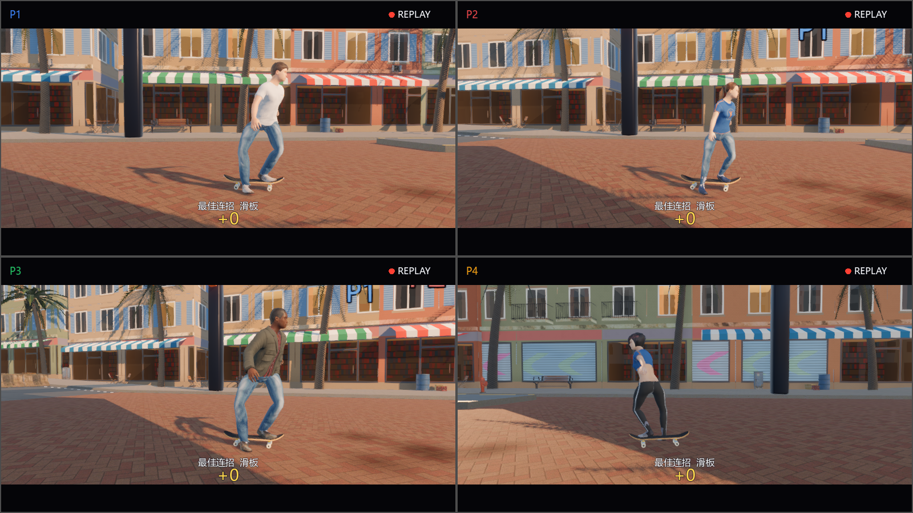
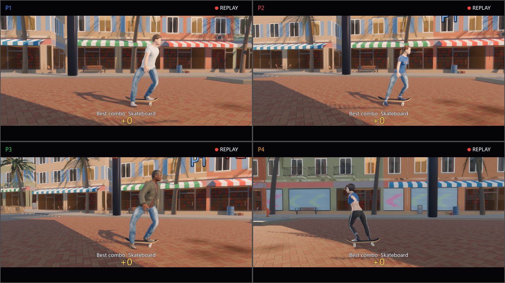

# 第十阶段：公共慢动作回放

滑板、滑雪、篮球改用 `core/replay.gd` 的 `RSReplay` 管理滚动录像的时间窗口、片段筛选、播放游标、帧对 / 插值比例和回放结束时间。每玩家单独持有游标，使用成绩阶段的 `phase_time`，没有全局慢放、异步计时器或新增节点。

运动项目仍决定最佳连招 / 跳跃 / 投篮、前后保留时长、人物姿势、球的轨迹、跟拍镜头、音效与领奖台。滑板 / 滑雪保留 0.45 倍速，篮球保留 0.4 倍速；回放上限分别为 8.5 / 9 / 9 秒，再加原有 0.3 秒尾停。成绩面板仍在领奖台开始后 1.6 秒出现。录像只在内存中，包含场景快照而非手柄输入，没有新增存档或录制文件。

重复采样同一时间不会重复报告落地事件，大帧间隔会报告全部新跨越帧。向后采样只重新定位，本次不触发事件；随后向前再次经过的帧可重新报告。重开和开始新的成绩回放时清空 / 重设游标，避免保留上一局片段。无片段或仅一帧时不采样，无人有片段时直接进入原有领奖台流程。

## 验证

- 时间线与边界：4088 项通过。覆盖 1000 帧滚动窗口、精确裁剪边界、16 组不规则 / 重复时间戳、负数 / 零倍速、越界时间、大步进、暂停重复采样、反向定位、独立玩家游标、空 / 单帧片段、重设与各项目时长上限。
- 场景矩阵：无头 29 用例、9820 项检查；原生 Windows 1600×900 的 29 用例、9816 项检查，均 0 失败 / 非预期引擎错误。覆盖全部 7 组地图 × 双人 / 四人 × 中英文，包含实际快照变换 / 姿势、篮球可见性和位置、分数不重复、暂停、单玩家缺片段、领奖台交接、重开及全部无片段。球体只在对应帧存在时核对变换，因此总检查数随真实机器人快照略有变化。
- 原生输出 28 张截图，已检查四人英文全地图总览，以及滑板 / 滑雪 / 篮球与中英文代表画面。
- 完整回合：全部 7 组地图的双人 / 四人演示，共 14 场通过；菜单和六项目共 15 项启动检查通过。直接限帧退出的旧启动检查仍有原有资源保留提示，严格退出的本阶段测试没有非预期引擎错误。
- 工具 58 项及 79 子测试、中枢 62 项、Node 24.22.1 素材测试 8 项通过；Ruff 与规范通过，只有 3 项已有 SIZE 警告；i18n 385 条、0 缺失 / 多余。
- 素材与隐私扫描：0 发现、0 待补许可记录。

运行 `python tools/test_replay.py` 验证全部 7 组地图 × 双人 / 四人 × 中英文；`--screenshots` 使用原生 1600×900 窗口。测试先运行真实机器人并调用项目原有录制路径，再从实际快照构造测试片段，对照独立时间戳搜索验证人物和球、分数不重复、暂停、领奖台交接与重开。此测试不以短时间内机器人能否选出精彩动作作为通过条件；完整机器人回合另行覆盖原有最佳片段选择流程。

轻量 CI 用 `--math-only`，脚本沿用受管理的引擎、隔离演示玩家、唯一正数检查标记和零非预期引擎错误要求。没有在提交中保存测试录像或真实设备数据。

## 原生画面

两张图为原生 1600×900 四人滑板回放，来自现有 MIT 界面、CC0 场景 / MPFB 素材的实际渲染。为稳定验证姿势，测试从实际机器人快照选取片段并显示项目名，截图不代表某次最佳连招的分数或名称；没有引入新的第三方素材。来源沿用 `docs/THIRD_PARTY.md` 与素材目录中的许可记录。

## 范围与后续

跨区修改公共框架及架构接口、滑板 / 滑雪 / 篮球回放调用、工具 / CI 和文档，服务于用户授权的公共演出 TODO。没有新增依赖、autoload、业务存档或协议消息；原有比赛物理、手势、计分与画面参数保持不变。

公共开场和本阶段为独立 PR，均从 `dev` 建分支。本阶段不依赖开场实现；合入后路线图应保留两个阶段的完成项。公共领奖台仍待后续阶段，因此公共演出总项保持未完成。未验证真实手柄、断连重连、BLE、HDR、VRR 与跨平台画面。
