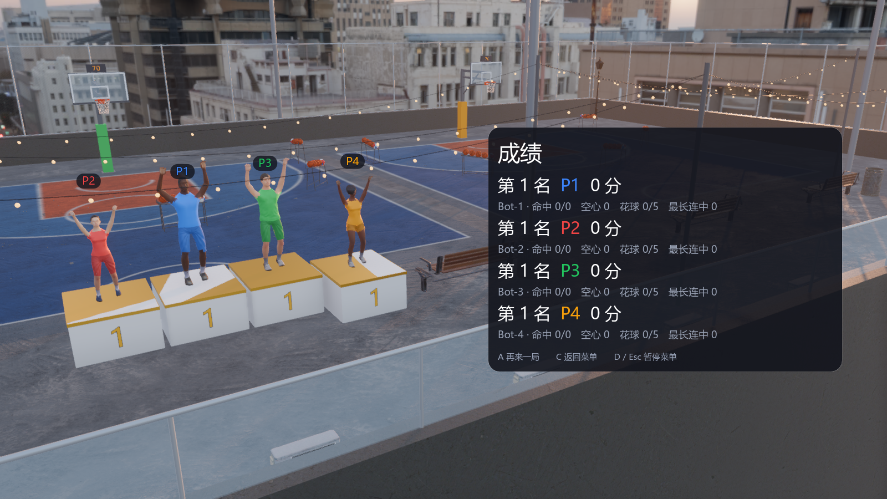

# 第十一阶段：公共领奖台

滑板、滑雪、篮球改用 `core/podium.gd` 的 `RSPodium`，统一台阶建模、站位、名次 / 庆祝等级和镜头推进。项目仍负责人物姿势、音效、回放交接与场景显示；滑雪继续修正普通第四名脚下的地形高度。保留三项目原有台面宽深、雪地埋深、名次高度、材质参数、相机 FOV 和六秒推进参数；篮球初始机位抬到 3.5 米，避开后退取景时的楼顶玻璃护栏。

## 玩家能看到的变化

- 领奖台采用成绩页已有的稳定顺序：分数优先，同分按玩家编号排列。名次仍是竞赛排名，例如 1、1、3；没有改分数、派对积分或纪录规则。
- 同名次玩家使用相同的台面高度、奖牌色、编号和庆祝等级。第四位并列前三时也有台阶，并向外留出间隔；普通第四名保持地面站位。
- 在原镜头上进行平移 / 后退，保持 FOV 与朝向，让台阶、人物和 P 编号落在左侧，右侧成绩面板不再挡住第四位玩家。
- 暂停冻结原有成绩时钟；重开隐藏领奖台、清空上一局名次并恢复分屏 / 滑板，不重复建立节点、网格或材质。

加载时只创建一次四组可复用的方台 / 饰条 / 编号；普通第四台默认隐藏。每帧镜头使用预先缓存的八个包围盒角点解取景范围，不增加定时器、autoload 或每帧节点 / 材质 / 数组分配。

## 验证

- 数学、名次和几何：5205 项通过。覆盖三个场地参数、独立的排名预期、同分 / 负分、超过 32 位范围的正负分数、台面与脚下高度、带父节点变换的世界坐标、六秒镜头端点、两种 FOV 保持方式、左侧取景与重复更新稳定性、重置 / 零玩家、零距离垂直视线。
- 完整无头矩阵：29 用例、9685 项检查通过，含上述数学检查。覆盖七组地图 × 双人 / 四人 × 中英文；每场依次检查正常名次、部分并列、全员并列、大正负分数，核对实际姿势 / 站位、比分不变、右侧成绩、暂停、重开和节点复用。
- 原生 Windows 1600×900：完整 28 场景用例、56 张正常 / 全员并列截图通过。复核发现篮球后退机位会隔着护栏拍摄，调高机位后重跑篮球两地图 × 双人 / 四人 × 中英文的 8 场景，1744 项场景检查通过，另输出 16 张截图；其中增加逐玩家、逐镜头时刻的脚下视线高于护栏断言。最后一次运行连同数学共 9 用例 / 6949 检查，均 0 失败 / 非预期引擎错误。已复核英文四人全部地图总览与中英文代表画面。
- 完整回合：七组地图双人 / 四人演示共 14 场通过；菜单与六项目共 15 项启动检查通过。旧启动脚本直接限帧退出仍有资源保留提示；本阶段严格退出的场景检查没有非预期引擎错误。
- 工具 58 项及 79 子测试、中枢 62 项、Node 24.22.1 素材测试 8 项通过；Ruff 通过，规范 0 错误 / 3 项已有 SIZE 警告，i18n 385 条、0 缺失 / 多余。
- 素材与隐私扫描：0 发现、0 待补许可记录。

`python tools/test_podium.py` 执行完整场景矩阵；`--screenshots` 使用原生 1600×900 窗口，逐地图输出正常 / 全员并列画面；轻量 CI 使用 `--math-only`。实际场景使用隔离机器人档案，测试主动指定分数以稳定重现并列，不代表玩家真实成绩。脚本要求唯一正数检查标记和零非预期引擎错误，沿用受管理的引擎及临时数据清理。

## 原生画面

截图为原生 1600×900 的四人篮球并列领奖台，已采用避开护栏的最终机位，来自现有 MIT 界面、CC0 场景 / MPFB 素材的实际渲染，使用隔离演示玩家和测试分数。没有引入新的第三方素材；来源沿用 `docs/THIRD_PARTY.md` 与素材目录的许可记录。

## 范围与后续

跨区修改公共框架及架构文档、三个项目的领奖台调用、工具 / CI、路线图和截图许可记录，服务于用户授权的公共演出 TODO。没有新增依赖、autoload、存档或协议消息，也没有改派对总领奖台的二维界面。

本阶段从 `dev` 独立建分支，不包含公共开场 PR #17 和公共回放 PR #18；三项全部合入后再汇总勾选公共演出总项，并做组合回归。真实手柄 / BLE、HDR / VRR、跨平台画面和帧率目标仍需另行验证。
