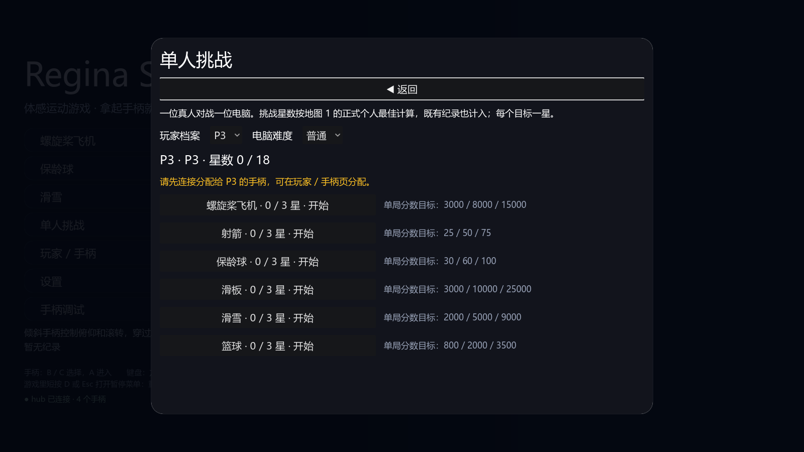
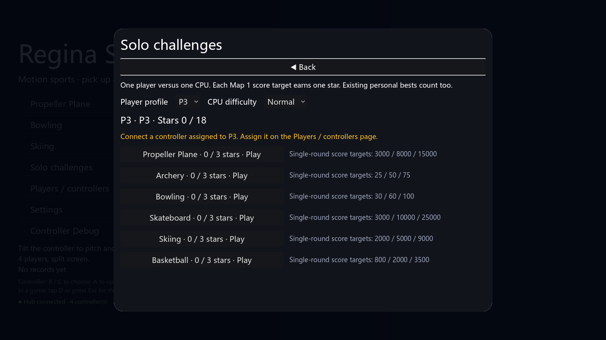

# 第三阶段：电脑对手与单人挑战

主菜单进入“单人挑战”，选择 P1–P4 档案、简单 / 普通 / 困难，再选择运动项目。需要连接一个分配给该槽的手柄。进入后保留教学、地图选择、大厅准备、暂停、重开和成绩流程。真人离线时电脑不能自己开局；旁观手柄不加入、不占电脑槽，也不能切走比赛。

电脑参与正常物理和排名，不直接改分。难度分别影响飞机瞄准偏差与加速条件、射箭散布、保龄球站位与弧线误差、滑板平衡与动作失误、滑雪路线误差与速度、篮球投篮散布。`--demo` 使用原有参数；正式单人会话只允许真人写纪录，电脑不会写入另一档案的成绩。

每项目有三档分数目标，每档一星，总计 18 星。目标基于地图 1 的正式个人最佳，旧的正式纪录也计入；其他地图的纪录照常保存，但不参与这组星数。难度不改变分数或星数计算，不新增进度文件。

| 项目 | 一星 | 二星 | 三星 |
|---|---:|---:|---:|
| 飞机 | 3000 | 8000 | 15000 |
| 射箭 | 25 | 50 | 75 |
| 保龄球 | 30 | 60 | 100 |
| 滑板 | 3000 | 10000 | 25000 |
| 滑雪 | 2000 | 5000 | 9000 |
| 篮球 | 800 | 2000 | 3500 |

射箭满分为九箭共 90 分；目标均在其范围内。这些是首版分数挑战，尚未提供计时、指定动作或职业生涯任务。目标和难度仍需真人试玩校准；固定随机种子的自动回合不意味着每一局困难电脑都必胜。

篮球 HUD、开场覆盖与回放文字移入 `basketball_hud.gd`，规则仍在原脚本；主脚本降至 1000 行以内。改动没有新增游戏素材或依赖。

回归入口：`python tools/test_solo.py --all-maps`。从真实菜单启动，使用本机回环 UDP 输入；验证缺手柄阻止启动、旁观隔离、等待真人、断线重连、暂停、自然结算、真人存档、电脑不写档、再来一局与返回菜单。全部地图 × 三档难度共 30 组。射箭 / 保龄球由模拟真人执行按住与松开，仍走实际控制器和玩法路径。无头加速运行会给音频线程留出真实收尾时间，运行器继续拒绝退出泄漏。

截图入口：`python tools/test_solo.py --screenshots --levels 1 --language zh`（或 `en`）。截图模式检查菜单、大厅、比赛及成绩布局，提前结算，仅写运行器创建的临时测试存档，以显示真实成绩页的星数；报告明确标为布局测试，不替代自然回合测试。输出原始 1600×900 PNG、逐项报告、日志和 HTML 画廊。CI 的轻量任务覆盖三个基础运动，完整资源打包任务覆盖全部地图。

仍未验证：实体 BLE / 手机手势体验、难度公平性、挑战目标对新手的适合程度、HDR / VRR 与长时间游玩。

本阶段本地验证：30 组自然回合通过；5 组星数重读 / 地图隔离补充检查通过；全地图中英文布局 20 组、星数成绩页额外 4 组、篮球两地图中英文四人截图 4 组通过并已查看。六项目的 2 / 4 人完整演示回合各 6 组、三项目派对流程、15 项启动检查通过。工具测试 49 项及 46 个子测试、中枢 62 项、素材同步 8 项通过；规范 0 错误（3 条既有 SIZE 警告）、文案 0 缺失 / 0 多余、隐私扫描无发现。启动检查仍按既有规则单独报告退出资源缓存诊断。

## 界面截图

以下两张 1600×900 PNG 由本项目的静态菜单直接渲染并原样复制，使用虚构 P3 测试档案。内容为本次贡献的程序界面，不包含新的第三方图片、采样或字体文件；随项目文档按 MIT 分发。

