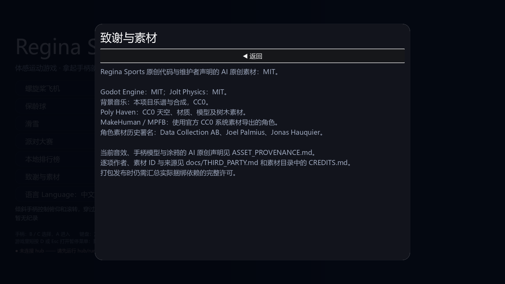
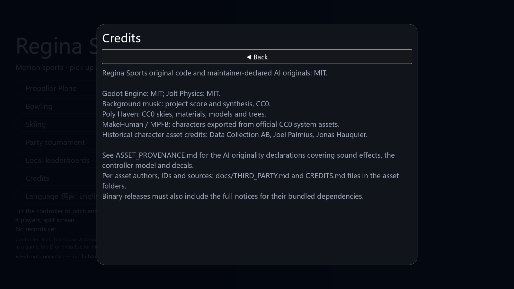

# 第四阶段：背景音乐

主菜单播放 104 BPM 循环曲，大厅播放 88 BPM 循环曲；倒数开始时淡出，比赛期间只保留原有环境声和音效。结算播放一次六秒胜利短曲，回大厅恢复大厅音乐。所有音乐走已有 Music 总线，音乐音量为零时静音，暂停随场景树暂停，换场景释放播放器。

`RSMusic.attach(parent)` 对同一父节点复用播放器；切曲取消旧淡出，避免旧回调停止新曲。原有音量菜单和 `settings.cfg` 格式不变，没有新增 autoload 或运行依赖。

三首音乐的乐谱、合成器、确定性节奏与输出记录都保留在 `tools/build_music.py`。只用正弦谐波、包络与带种子的噪声打击乐，无外部采样或参考歌曲。WAV 输出以 CC0-1.0 提供；脚本使用项目 MIT。完整来源记录见 [CREDITS.md](../game/assets/music/CREDITS.md)，不要将其混同于先前音效的维护者原创声明。

音频为单声道 22050 Hz / 16-bit PCM，总计约 2 MB。生成记录含 SHA-256、时长、BPM、峰值、RMS 与首尾差。循环边界经过 12 ms 淡化，峰值低于满幅。音量与频谱的自动检查不能替代扬声器 / 耳机上的试听和混音评价。

验证入口：`python tools/test_music.py` 检查实际播放器、循环、自然结束、总线隔离、静音、暂停 / 恢复、快速切曲、重复结算、游戏 / 菜单释放；`python -m pytest -q tools/tests/test_music_assets.py` 校验提交的音频数据和生成记录。轻量 CI 包含这三首音乐并运行实际播放器测试。

本阶段验证：音乐集成 25 项通过；外壳 / 三项目派对严格检查重复三次通过，无退出泄漏；六项目 2 / 4 人完整回合各 6 项、15 项启动检查通过。工具测试 50 项及 43 个子测试、中枢 62 项、Node 素材同步 8 项通过；规范 0 错误（4 条既有 SIZE 警告），文案 0 缺失 / 0 多余，隐私 / 来源检查无发现。启动检查仍按既有规则单独报告退出资源缓存诊断。音乐无损导入的实际格式、采样率和声道数也已验证。

## 界面截图

音乐来源已补入游戏内中英文致谢。以下为本项目静态界面直接渲染的 1600×900 截图，无新增第三方图像或字体文件，随程序文档以 MIT 分发。

