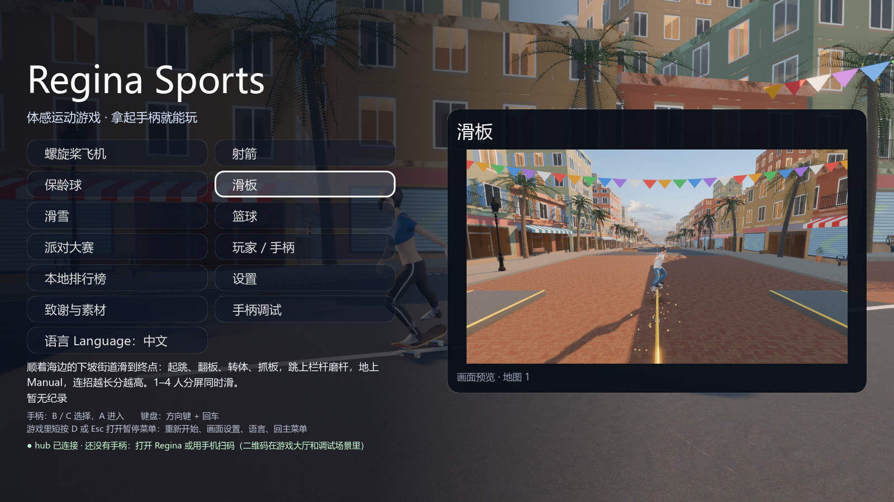
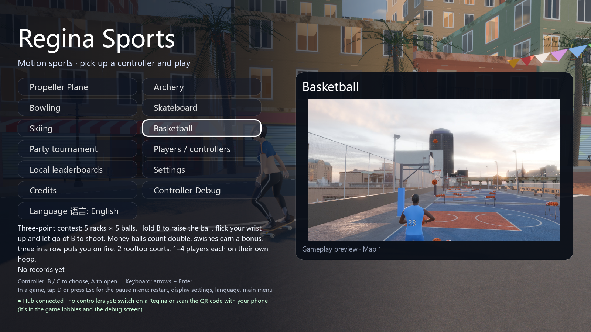

# 第五阶段：主菜单项目预览

六个运动项目的菜单焦点现在同步显示项目名和实际游戏画面。右侧卡片标明“地图 1”；设置、档案、排行榜等入口隐藏预览。打开页面再返回、首尾循环、缺图后重新选择都能恢复正确状态。

预览是缓存的静态 Texture2D，不额外实例化运动场景。首次读取每张图，之后按项目 ID 复用；原有动态滑板背景继续运行。六张 JPEG 合计 1,110,857 字节，均为 1600×900。

## 来源与重建

`python tools/capture_previews.py` 使用真实游戏、单个演示机器人、地图 1、中画质，等待比赛开始后的指定时间，从玩家 3D SubViewport 导出，不含 HUD。每个游戏使用隔离的临时用户目录，不读取或改写玩家存档。

`game/tests/capture_preview.gd` 保留时间点，`game/assets/previews/manifest.json` 保留文件大小与 SHA-256。先验证引擎退出、完成标记和图片尺寸，再替换原图，失败不会覆盖最后一份有效图片。图形驱动可能改变渲染细节，不声称跨机器逐像素一致。

图片包含 MIT 项目代码/几何及现有 CC0 场景素材，来源链见 [CREDITS](../game/assets/previews/CREDITS.md)。没有新增第三方图片或依赖。

## 验证

- `python tools/test_menu_preview.py`：中文、英文各 142 项检查通过；使用真实菜单、键盘事件、鼠标事件、二进制 UDP 手柄输入，检查焦点、标题、说明、纹理、尺寸、位置、缓存、页面返回和缺图恢复。
- `python tools/test_menu_preview.py --screenshots --backdrop`：两种语言各 154 项检查通过，保留 12 张带动态背景的原生 1600×900 图片。
- `python tools/capture_previews.py`：六个项目实际相机导出成功，无引擎错误、脚本错误或退出泄漏。
- `python tools/check_conventions.py`：0 错误，4 项已有大脚本警告；`python tools/i18n_check.py`：367 文案，0 缺失、0 多余。
- 工具测试 50 项及 47 项子测试、中枢 62 项、Node 素材同步测试 8 项通过；隐私扫描无发现。
- `python tools/smoke_test.py --players 2` 与 `--players 4`：六项目完整回合共 12 项通过，无引擎错误、脚本错误或退出泄漏；`python tools/test_game.py`：0 失败。
- `python tools/smoke_game.py <Godot> --project game`：15 个启动用例通过。原有短时强制退出资源保留提示仍存在，该工具明确排除这项诊断；没有将它计作完整回合的通过证据。

菜单测试已经加入 CI，轻量检出包含预览图片，无需下载完整场景素材。无界面测试显式设置逻辑窗口尺寸，原生图形截图另行验证。

## 范围与限制

跨区修改涉及菜单、翻译、素材、生成/验证工具及 CI，服务于用户授权的 TODO 完善；不更改运动规则、协议、存档结构或项目启动接口。六张图只代表地图 1，不表示其他地图或实际硬件帧率。UDP 输入属于软件回归，实体 Regina/BLE、手机手感、HDR 和 VRR 未验证。其余阶段 PR 保持独立，以 `dev` 为目标，尚未合并。
