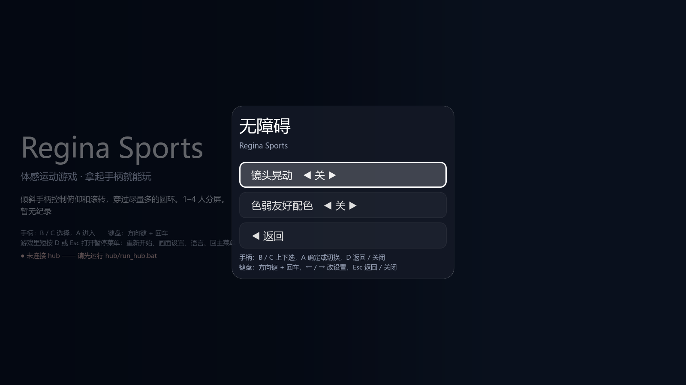
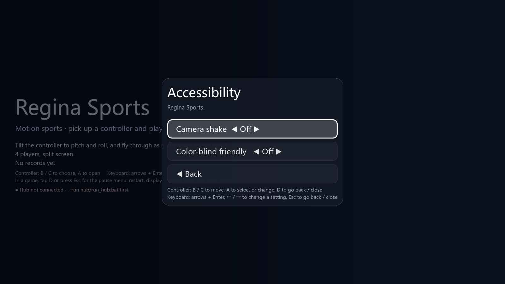

# 第六阶段：镜头晃动开关

主菜单设置和游戏暂停菜单新增“无障碍”页，包含镜头晃动与原有色弱友好配色。关闭晃动后，滑板、滑雪的碰撞随机镜头位移和瞄准点扰动都归零；正常跟随、速度视野变化和开场镜头仍保留。

设置保存在现有 `settings.cfg` 的 `accessibility.camera_shake`，默认开启，旧档案保持原行为。新字段只接受布尔值，错误类型回退默认。无新增存档文件、依赖、autoload 或协议消息。

随机偏移仍按原顺序生成，再决定是否应用；这避免视觉开关改变与玩法共享的随机数状态。测试在真实场景中对同一随机状态分别开关镜头，比较相机位置、朝向、随机数状态、玩家位置/速度与分数。

## 验证

- `python tools/test_camera_comfort.py --screenshots`：中英文设置与独立进程重载、滑板/滑雪双人和四人相机，8 个用例共 148 项检查通过；原生 1600×900 截图已检查。
- `python tools/test_camera_comfort.py --ui-only`：无界面中英文设置与重载共 34 项检查通过，加入 CI 的轻量检出任务。
- 规范检查 0 错误、4 项已有 SIZE 警告；369 文案，0 缺失、0 多余。
- 工具测试 48 项及 36 项子测试，中枢 62 项，Node 素材测试 8 项通过；隐私扫描无发现。
- 滑板及滑雪全部 5 组地图的双人、四人完整回合共 10 项通过；外壳测试 0 失败，15 项启动检查通过。启动工具仍报告部分短时退出资源保留提示，不将该项排除诊断混作完整回合的通过证据。

截图仅含项目 MIT 界面与纯色背景，由原生游戏测试导出，无第三方图片或真实玩家数据。

## 范围与限制

跨区涉及框架设置/暂停菜单、滑板和滑雪镜头、翻译、测试工具/CI 与文档，用于用户授权的无障碍 TODO。此项只完成镜头晃动开关，字号和左手模式继续保留待办；不声称关闭所有镜头移动或解决所有晕动不适。软件回归不能替代实体手柄/BLE、手机手感、HDR、VRR 或个人舒适度验证。
