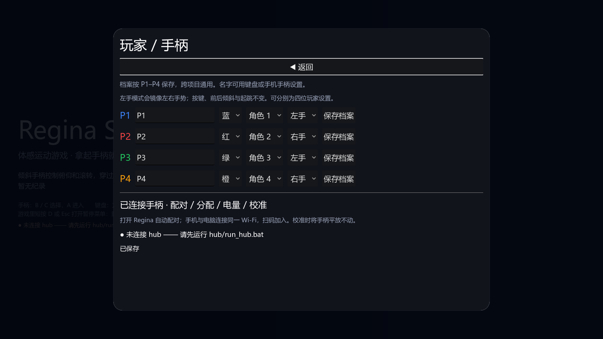
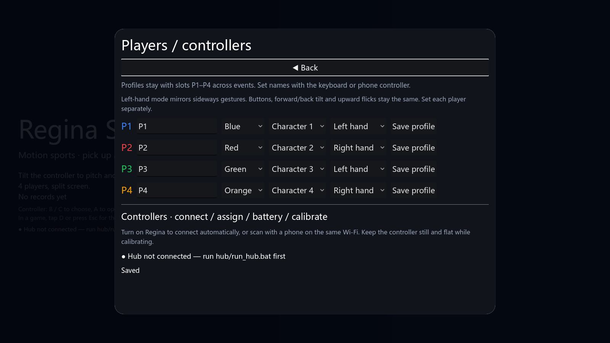

# 第七阶段：按玩家保存的左手手势模式

“玩家 / 手柄”页可以为 P1–P4 分别选择左右手，同一场比赛可混用。选择后点击该行“保存档案”。偏好保存在原有 `profiles.cfg`，旧档案默认右手；原有四参数 `RSProfiles.update` 保持当前手势偏好，保存失败回滚内存状态。

左手模式镜像左右倾斜、转体、翻板、射箭横向瞄准、保龄球扭腕和篮球横向瞄准。按键、前后倾斜、抬腕、速度、力度与时序不变。教学同步反转动画和方向提示，练习要求实际向左倾斜；错误方向不会完成教学。

## 输入与架构

原始姿态、角速度、历史缓冲保持协议原值，调试模型和数据录制不改写。`RSController` 提供读取层：旋转采用 `M R M`，其中 `M=diag(-1,1,1)`；角速度属于轴向量，采用 `-M g`。六项目、公共动作检测与教学在读取时转换，校准参考姿态也使用同一转换。

篮球沿用 dev 中阶段三提取的 `RSBasketballHud`，输入与计分状态仍由游戏持有。此阶段基于当前 dev 集成，使用带校验的档案读写和统一 `RSExit` 退出流程。

## 验证

- `python tools/test_left_hand.py --screenshots`：16 个用例、526 项检查通过。含 24 组姿态/角速度数学验证、原始历史保持、左右手混合输入、动作时序、教学方向、四玩家独立保存、新进程重载，以及六项目双人/四人真实输入路径。
- `--ui-only`：中英文无界面回归共 458 项检查通过，已加入轻量 CI。
- 中英文原生 1600×900 档案页截图已检查，四行控件均在屏幕内且互不重叠。
- 规范 0 错误、3 项已有 SIZE 警告；390 文案，0 缺失、0 多余。
- 工具 58 项及 79 项子测试、中枢 62 项、Node 8 项与 Ruff 全量检查通过。
- 六项目全部 10 组地图的双人/四人完整回合共 20 项通过；外壳 0 失败，存档 62 项检查与新进程重载、三项目派对连赛、15 项启动检查通过。短时退出仍存在工具明确排除的已有资源保留诊断。
- 篮球两地图的中英文四人原生 HUD 截图共 4 项通过并已检查，验证提取后的界面；隐私扫描无发现。

截图为项目 MIT 界面和纯色背景，由原生测试导出，使用隔离测试档案，无真实玩家数据或第三方图片。

## 范围与限制

跨区涉及档案、手势读取、教学、菜单、六项目输入、工具/CI 和文档，服务于用户授权的无障碍 TODO。无新增依赖、autoload、存档文件或协议消息。左手模式改变输入解释，角色持球/持弓模型仍使用现有动作；不声称实现人物动画左右换手。输入验证使用软件构造的传感器样本，实体 Regina/BLE、手机握持手感、HDR 和 VRR 未验证。字号选项继续保留待办。
