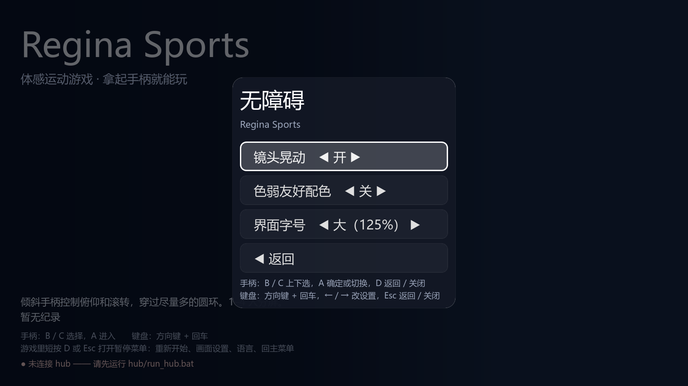
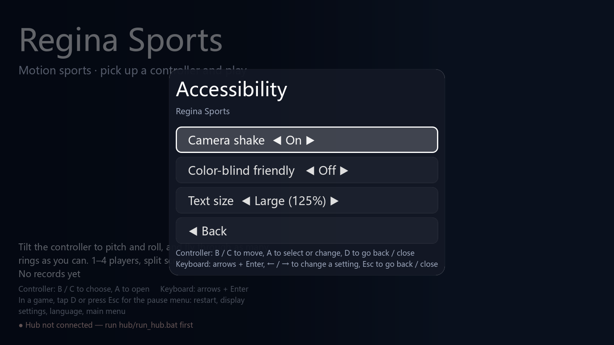

# 第八阶段：界面字号

主菜单“设置 → 无障碍”和比赛暂停菜单共用“界面字号”，可在标准（100%）与大（125%）之间切换。设置沿用 `settings.cfg` 的版本、校验与备份恢复；旧存档默认标准，错误类型回退标准，越界整数限制到有效选项。

切换即时更新已有界面，不重载场景、不改变暂停状态、比赛时间或成绩。新建控件直接使用当前字号。`RSUi` 保留控件、主题与成绩富文本的原始字号，重复应用不会累乘；回到标准时恢复原始尺寸，玩家名字的富文本转义保留原意。

## 布局

- 主菜单项目列表支持滚动跟随焦点，说明、操作提示与连接状态保持可见；子页同样跟随焦点。
- 教学说明、操作提示和成绩页帮助文字自动换行；成绩正文中的 BBCode 字号同步放大。
- 六项目共享的 HUD 绘字按实际字体宽度、基线与单个分屏边缘适配。空间有限的单行会缩小到可容纳的字号，因此并非每一处 HUD 都保证完整放大 25%。
- 计时胶囊背景跟随文字尺寸；四人计时器移到第一行分屏之间，避开 P4 标识；篮球为力量表预留空间，将计时器放在力量表下方、球架上方。
- 滑雪速度、团身提示与旗门面板按实际字宽排布，避免大号英文速度与 `Tuck` 重叠、文字伸出雪地遮罩。
- 将这部分滑雪统计 HUD 提取到 `RSSkiHud`，主场景保持在 1000 行以内；规则、运动状态与计时仍由原场景持有。
- 篮球命中提示、加分飘字与投完提示分行显示，包含命中动画最大字号的同时反馈检查。
- 3D 场景中的号码、场地标牌、开发调试图表和实体手柄 OLED 保持现有尺寸。

## 验证

- 原生 Windows 1600×900：44 个唯一用例、3278 项检查通过。含全部 10 组地图 × 双人 / 四人 × 中英文的 40 组布局、教学和成绩检查，以及菜单与新进程重载。滑雪、篮球在最后一次布局修改后重新执行全部对应地图。
- 无界面菜单 208 项检查通过；额外单人 / 三人飞机双语 210 项通过，包含三人计时标题与胶囊的间距。
- 菜单鼠标、键盘、UDP 手柄焦点与预览：中英文各 145 项检查通过。
- 全部 10 组地图的双人 / 四人完整回合共 20 项通过；15 项启动检查通过。启动工具对 `--quit-after` 直接退出时的已有资源保留诊断仍按既有规则排除。
- 外壳 0 失败；存档 62 项与新进程重开、三项目派对连赛通过。存档故意损坏和拒绝写入用例保留预期诊断。
- 规范 0 错误、3 项已有 SIZE 警告；388 文案，0 缺失 / 多余；Ruff 通过。
- 工具 58 项及 79 子测试、中枢 62 项、Node 24.22.1 下 8 项素材测试通过；隐私扫描无发现。

`tools/test_text_size.py` 使用隔离档案，严格检查引擎错误、非零检查数、唯一结束标记与截图尺寸；从项目实际地图列表发现用例。真实项目脚本的测试子类只记录绘字边界，不替换生产绘字实现。篮球还注入同时命中 / 加分 / 投完的最坏布局状态，完整比赛由独立的 `tools/smoke_test.py --players 2 / 4 --all-maps` 回归验证。

## 界面截图

两张设置截图均为原生 1600×900 导出，使用隔离测试档案、项目 MIT 界面与纯色背景，不含真实玩家数据或第三方图像。完整运动画面的本地测试证据不作为新增素材发布。

## 范围与限制

跨区涉及公共界面、设置、HUD 绘字、菜单、i18n、工具 / CI 与架构文档，服务于用户授权的无障碍 TODO。无新增依赖、autoload、存档文件或协议消息。不修改六项目物理、手势与计分；实体 Regina / BLE、手机操作、HDR、VRR 和其他系统字体尚未实机验证。小窗口、不同操作系统字体及更高缩放档位可继续完善。

后续优先补齐公共开场、回放和领奖台，减少滑板、滑雪、篮球重复的镜头与结算代码；性能优化应基于正在建设的实际渲染基准，分别检查四人阴影、3D 分辨率与 LOD 的成本。首次使用向导还需要把扫码、证书信任、连接检查和校准串起来，并用实体设备回归连赛与断线重连。现有便携包已发布 [alpha.2](https://github.com/cb8010d6/sport-games/releases/tag/v0.1.0-alpha.2)，路线图中的打包待办应另行核对更新，不能据此误判为尚无可运行发行包。
