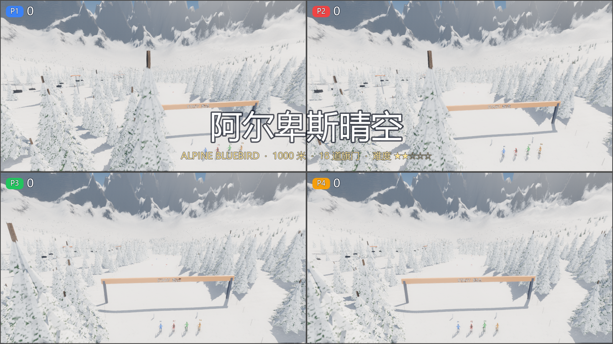
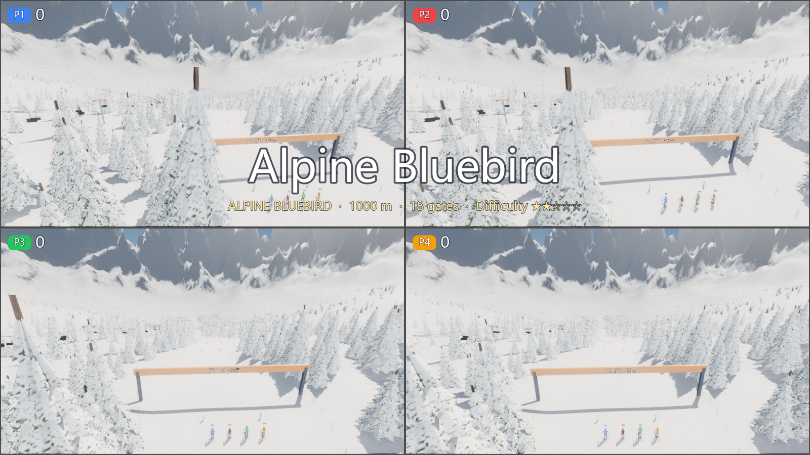

# 第九阶段：公共开场飞越

将滑板、滑雪和篮球重复的开场轨迹、视线切换、FOV 过渡与标题淡入淡出移到 `core/intro.gd` 的 `RSIntro`。项目仍提供各自地图的动态锚点和参数，公共层不引用项目类，也不持有场景节点。

`RSIntro.apply` 使用二次 Bézier 曲线和原有 smoothstep 进度。滑板保留 3.4 秒、50°→66°、视线延迟 0.25；滑雪保留 4.2 秒、55°→64°、延迟 0.3；篮球保留 4 秒、50°→47°、延迟 0.4。开场仍属于原有 COUNTDOWN 阶段，后续三秒倒数和跟随镜头由原场景负责。暂停冻结 `phase_time`，重开重置时间，不增加异步计时器或节点。

公共接口也处理零时长、视线目标与相机重合、垂直视线和短标题淡入淡出等边界，避免除零或无效相机朝向。每帧只计算数值、向量与相机属性，不分配节点、材质或数组。

## 验证

- 数学与边界：465 项检查通过。使用独立解析 Bézier 公式，含 16 组路径、越界时间、不同视线延迟、带变换父节点的世界坐标，以及退化视线和淡入淡出。
- 无界面真实场景：29 个用例、2929 项检查通过。覆盖 7 组地图 × 双人 / 四人 × 中英文，逐玩家验证六个轨迹采样点、视线、FOV、暂停冻结、进入比赛和重开；保留原场景锚点作为回归基准。
- 原生 Windows 1600×900：29 个用例、3013 项检查通过，输出全部地图双人 / 四人的中英文开场起点、中段、末段截图。已检查四人英文全部地图总览及中英文代表画面。
- 工具 58 项及 79 子测试、中枢 62 项、Node 24.22.1 素材测试 8 项通过；规范 0 错误、3 项已有 SIZE 警告，i18n 385 条 / 0 缺失 / 0 多余，Ruff 通过。
- 完整回合：滑板、滑雪、篮球的全部 7 组地图分别完成双人 / 四人演示，共 14 场通过；菜单与六个项目的 15 项启动检查通过。启动脚本直接限帧退出时仍有原有资源保留提示，严格退出的开场测试没有非预期引擎错误。

运行 `python tools/test_intro.py --screenshots` 执行实际地图矩阵；轻量 CI 使用 `--math-only`。脚本沿用受管理的引擎进程和隔离玩家数据，要求非零检查数、唯一结束标记和零非预期引擎错误。

## 原生画面

两张图为原生 1600×900 滑雪地图 1 的四人开场中段，来自项目已有 MIT 界面、CC0 场景 / MPFB 素材的实际渲染，使用隔离的演示玩家，不含真实设备或玩家数据。没有引入新的第三方素材；来源沿用 `docs/THIRD_PARTY.md` 和素材目录的许可记录。

## 范围与后续

跨区修改公共框架、滑板 / 滑雪 / 篮球相机与标题调用、工具 / CI 和文档，服务于用户授权的公共演出 TODO。没有新增依赖、autoload、存档文件或协议消息，不修改物理、手势、计分与原有镜头参数。没有扩大到尚未接开场的飞机、射箭和保龄球。

慢动作回放和领奖台仍是后续独立阶段，路线图的“公共演出模块”总项保持未完成。真实设备、BLE、HDR、VRR 与跨平台画面仍需实机验证。
