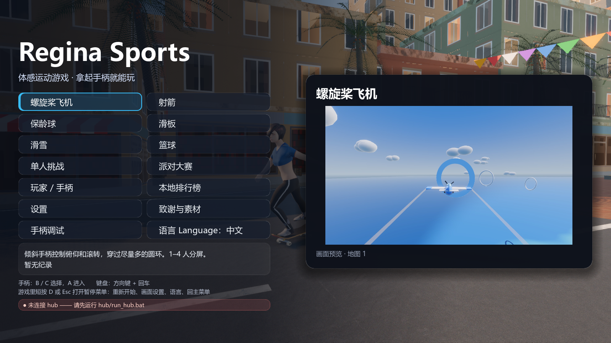
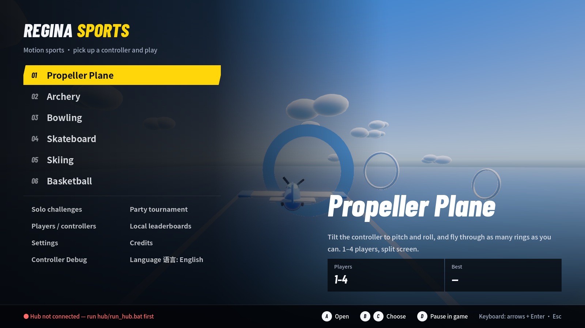
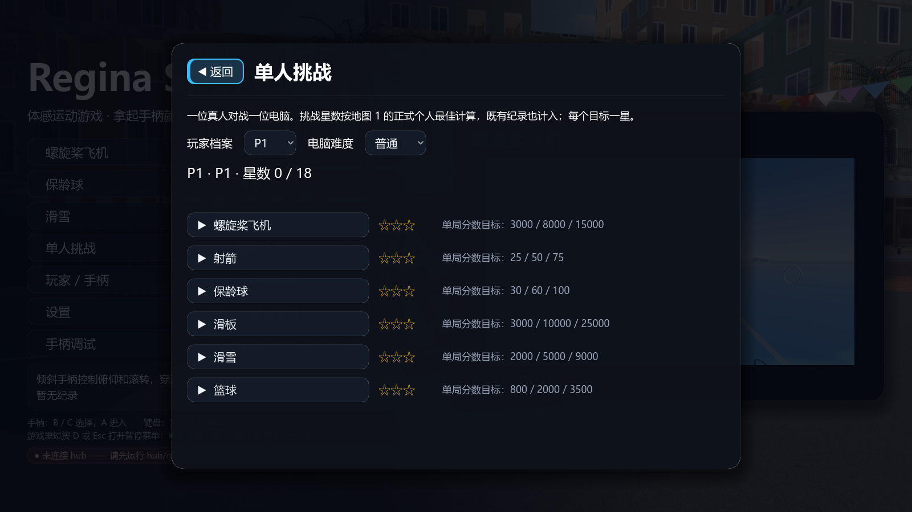
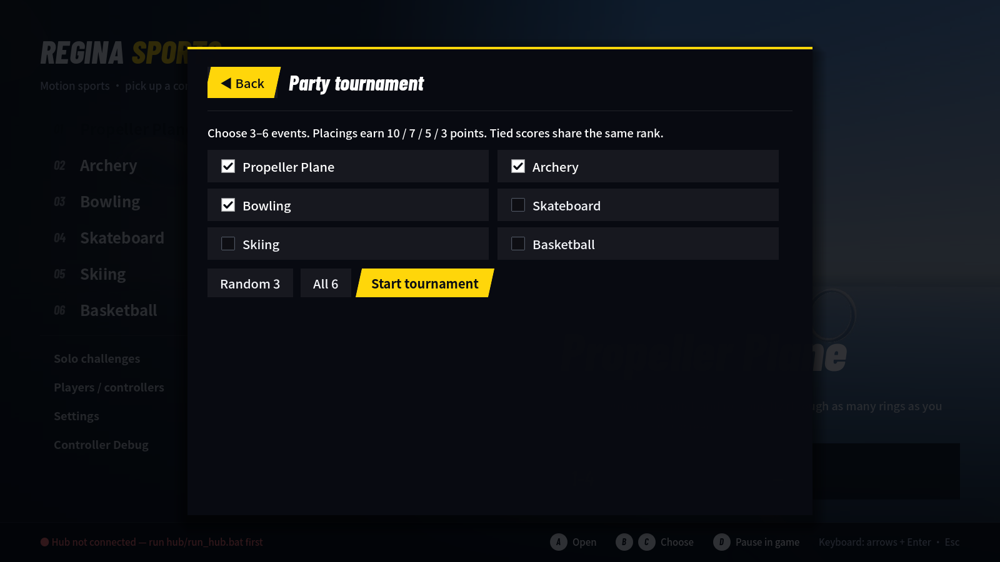
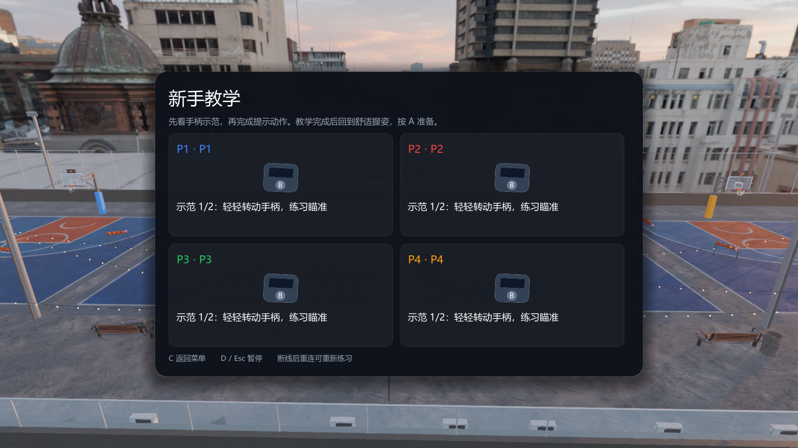
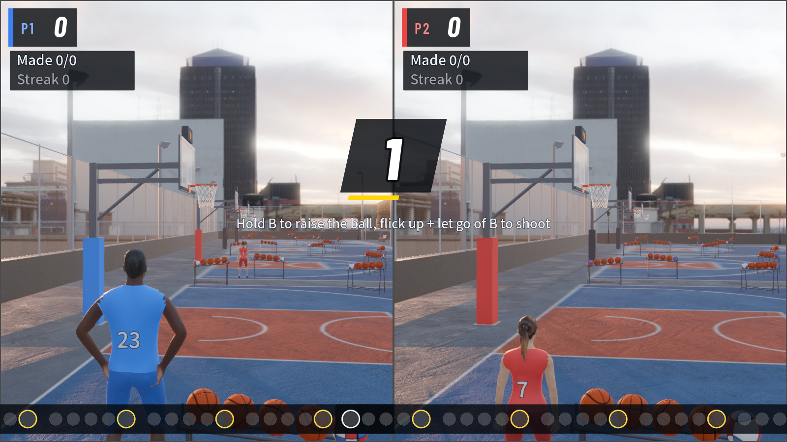
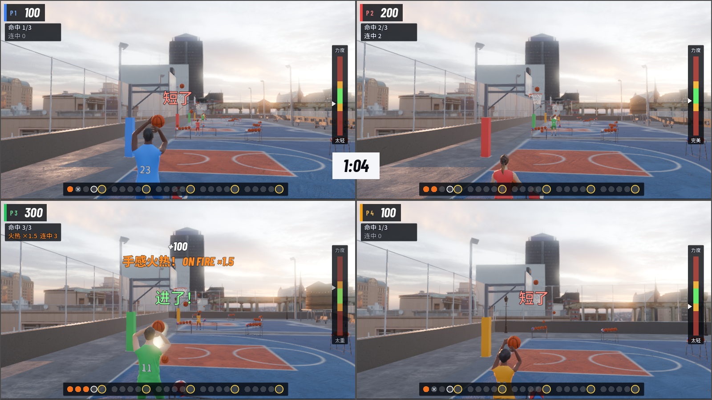
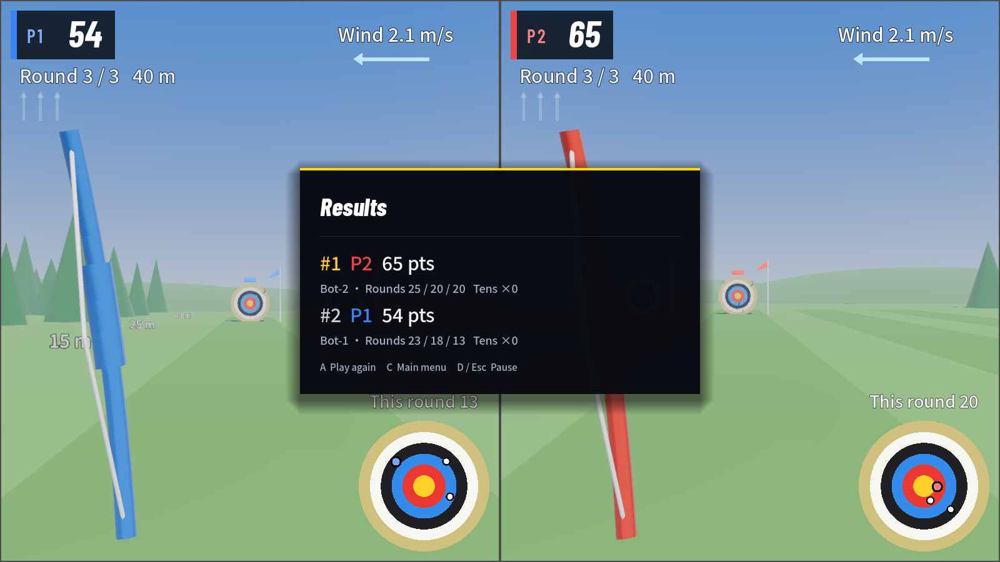
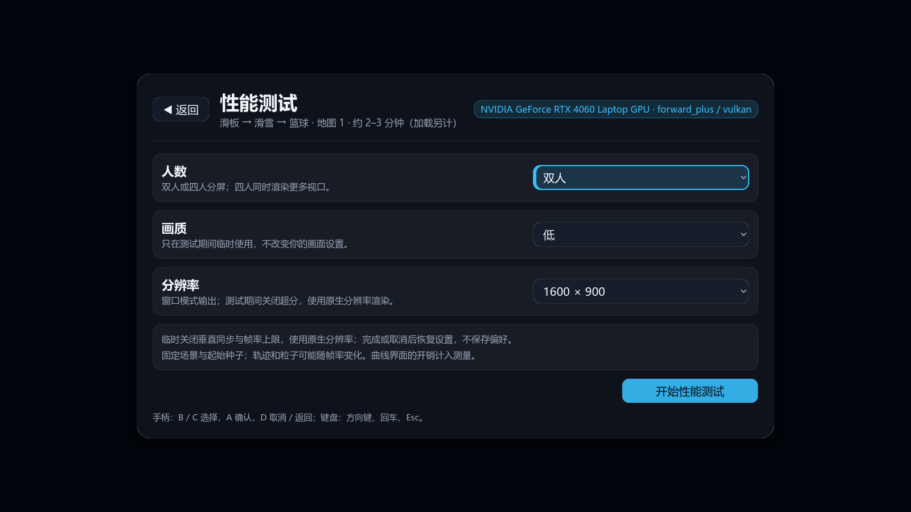
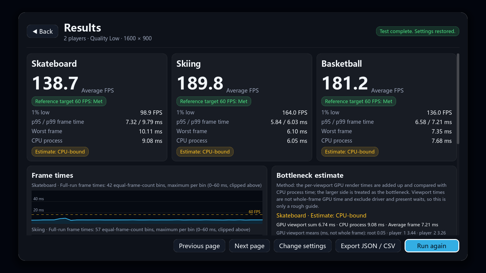

# 界面主题

所有 2D 界面（主菜单、菜单子页面、设置 / 暂停菜单、游戏大厅、新手教学、成绩、游戏内 HUD）共用 `game/core/ui_kit.gd`（`RSUi`）里的一套主题。风格参照体育转播和竞速游戏的菜单：深色底、方角、倾斜的高亮条、一种强调色（黄）、粗斜体数字。

根节点设置 `theme = RSUi.theme(字号)` 后，普通的 `Button`、`OptionButton`、`CheckBox`、`LineEdit`、`HSeparator`、滚动条和下拉列表就会自动使用统一样式，不需要逐个控件设置。

## 字体

字体随游戏打包在 `game/assets/fonts/`，不再依赖系统字体。许可都是 SIL OFL 1.1，见 [字体来源](../game/assets/fonts/CREDITS.md)。

| 函数 | 字体 | 用途 |
|---|---|---|
| `RSUi.font()` | Noto Sans SC Medium（500） | 正文、说明、按钮 |
| `RSUi.font_strong()` | Noto Sans SC Bold（700） | 列表里的项目名、玩家名、主要按钮 |
| `RSUi.font_bold()` | Barlow Condensed ExtraBold Italic，中文回退 Noto Sans SC Black（900） | 页面标题、logo、倒计时、加分飘字 |
| `RSUi.font_numeric()` | Barlow Condensed Bold Italic | 分数、计时器、统计数字 |
| `RSUi.font_label()` | Barlow Condensed SemiBold，字距加宽 | 小号英文标签（SKATE、P1） |

Noto Sans SC 是子集：包含游戏里出现的全部文字、GB 2312 一级常用字（3755 个，覆盖玩家名字）、Latin-1、标点和界面符号。子集以外的字会回退到系统中文字体。改了文案后，如果用到了生僻字，重新生成子集：

```sh
python tools/subset_fonts.py <google/fonts 的 NotoSansSC[wght].ttf>   # 需要 fonttools
```

## 颜色

| 常量 | 用途 |
|---|---|
| `TEXT` / `TEXT_MUTED` | 正文 / 说明和提示 |
| `ACCENT`（黄） | 唯一的强调色：选中项、主要操作、倒计时、进度 |
| `INK` | 强调色上面的深色文字 |
| `HIGHLIGHT`（橙） | 星数、地图信息、需要玩家处理的提示 |
| `GOOD` / `BAD` | 连接正常 / 未连接、最后 10 秒等状态 |
| `SURFACE`、`SCRIM`、`STROKE` | 弹出面板底色、面板后面的遮罩、细分隔线 |

玩家颜色仍由 `RSProfiles` 提供（包括色弱友好配色），主题不改动玩家颜色。

## 样式

- 方角：`RADIUS` 是 2，面板、卡片、HUD 底板都是 0。不要再用大圆角。
- `select_style()`：倾斜 `SKEW` 的实心强调色条。按钮的 hover / focus 都用它，文字变成 `INK`，鼠标和手柄的选中效果一样。倾斜的部分会超出控件左右各 `SKEW × 高度 / 2`，行与行之间要留出这点空间。
- 勾选框例外：Godot 按勾选状态而不是焦点选文字颜色，所以勾选框选中时是浅色底加左侧黄边，文字保持白色；勾是白底深色勾。
- `modal_style()`：盖在菜单或游戏上的完整面板，深色不透明，顶部一条强调色线，带阴影。
- `card_style()`：面板内的分组，略亮的平底色块，没有边框。
- `chip_style(颜色)`：状态标签，深底，左侧一条颜色条。
- `glyph_style()`：菜单按键圆标，28px 标签使用文字色底和 14px 圆角。
- `button_style(状态)`：普通按钮是半透明的平底色块。
- 每页唯一的主要操作（如“开始大赛”）设置 `theme_type_variation = &"RSPrimary"`：始终是黄色斜条，获得焦点时加白边。
- 标题用 `RSUi.font_bold()`，数字用 `RSUi.font_numeric()`。

## 主菜单

- 左侧：logo，编号的六个项目（01–06，中文名加英文标签），分隔线下面是两列的模式和设置。
- 背景：选中项目时全屏显示该项目的预览图（`RSGamePreview`），左侧和底部压暗。预览图完全显示时，后面的实时滑板街景停止渲染和模拟，省 GPU。选中非项目条目时，街景会重新出现。
- 右下：标题区，包括项目名、英文标签、说明，以及“人数”“最佳成绩”两格数据。
- 底部：一条按键提示栏，左边是 hub 状态，右边是手柄按键（白色圆形按键图标）和键盘提示。

## 游戏内 HUD

各项目在 `_draw_hud` / `_draw_overlay` 里通过 `RSPartyGame` 的共享函数画 HUD，这些函数统一使用主题：

- `draw_text(…, f)`：带描边的文字，字号随无障碍设置缩放；最后一个参数可以换字体（例如 `RSUi.font_bold()`）。
- `draw_pill`：短提示，深色方底；有颜色的提示在左侧加一条同色竖条。
- `draw_box`：实心色块，用于进度条、字母格和计量条，默认 `RSUi.RADIUS`。
- `draw_clock`：白底深色数字的转播式计时牌；最后 10 秒变成红底白字，并按秒轻跳。
- `_pill`：项目自己画的统计面板背景，深色方底（`RSUi.hud_style()`）。
- 左上角分数牌：玩家颜色竖条、`P1` 标签、斜体分数，分数变化时轻跳一下。
- 倒计时：倾斜的深色底板上显示大号斜体数字，下面一条黄色进度条每秒走完一次。GO! 显示在黄色斜底板上，稍微放大后淡出。
- 加分飘字使用 `font_bold()`。

## 动效

动效都很短（不超过 0.3 秒），只用于提示状态变化，不挡操作，也不影响测试判断。

- `RSUi.pop_in(控件)`：面板出现时淡入并轻微放大。用于菜单子页面、设置 / 暂停菜单和成绩面板。
- `RSUi.ease_out(t)`：HUD 里分数轻跳、加分飘字、倒计时数字的缓动。
- 主菜单的预览图切换时会短暂淡入。

HUD 动画共用 `RSUi.snap_font_size()` 的固定字号台阶：小于 64px 时按整数，之后每个二倍区间的步宽固定，档距最多约 3.125%。字号变大时不会倒退，已量化的值再次量化不变。`draw_text` 的字体度量和边界适配同样量化；分数弹跳、popup、倒数、GO! 和项目里的文字脉冲均使用这套策略。它减少大字号动画的位图光栅组合；小字号仍以清晰度为先，是否可见跳动、字体内存及帧时间需在 2／4 人、中英文与 100%／125% 字号下检查。

## 截图

1600×900，Godot 4.7.2 实际渲染。菜单背景和预览图包含 CC0 的 Poly Haven 素材。

| 中文 | English |
|---|---|
|  |  |
|  |  |
|  |  |
|  |  |
|  |  |

复现截图：

```sh
<Godot> --path game --resolution 1600x900 res://tests/ui_capture.tscn -- --ui-shots=out/ui
```

性能测试页的截图由 `python tools/test_benchmark.py --godot <Godot> --screenshots --players 2 --output out/bench` 生成，见 [性能测试](PERFORMANCE.md)。

## 没有覆盖

- 手柄调试场景是开发工具，保留原来的样式。
- 各项目内部的专用图形（篮球的投篮记录点、滑板的平衡表、滑雪的旗门标记）沿用项目自己的配色，只换了底板和字体。
- 手机网页（`hub/regina_hub/web`）还没有改成这套配色。
- 打包发布时，要确认 `game/assets/fonts/OFL-*.txt` 随安装包一起分发（Godot 默认不会把 `.txt` 导出进 pck）。
