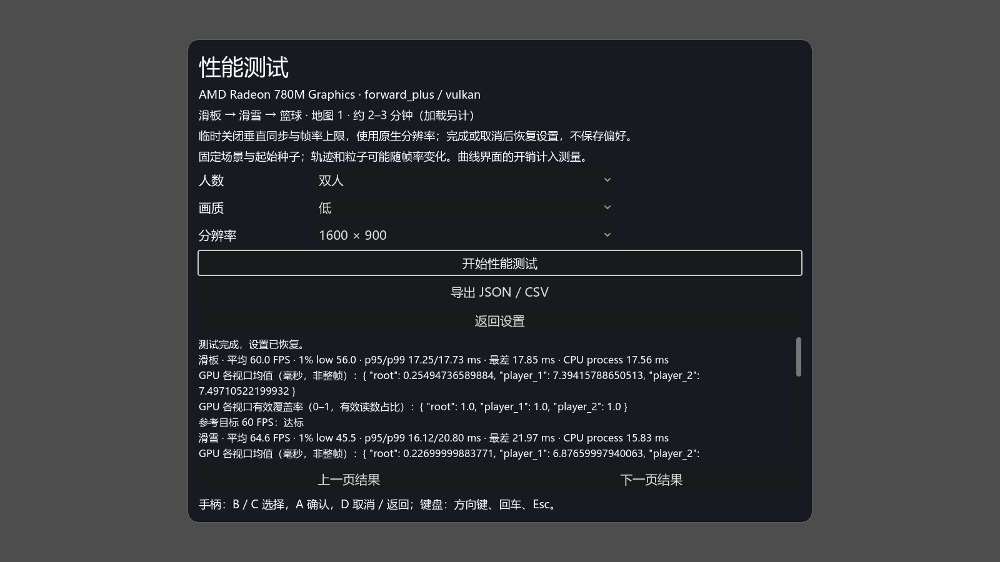
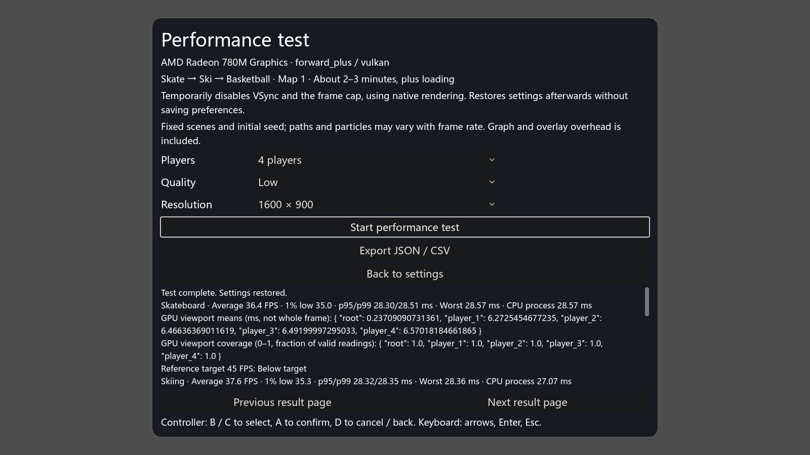
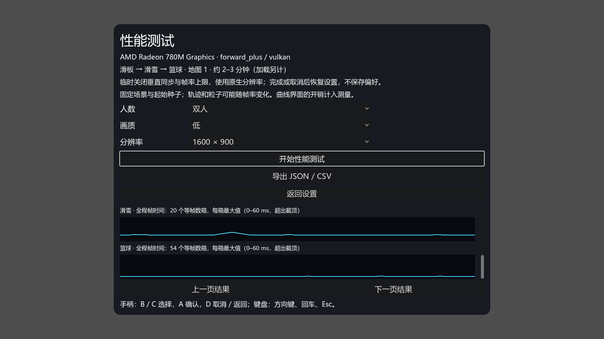
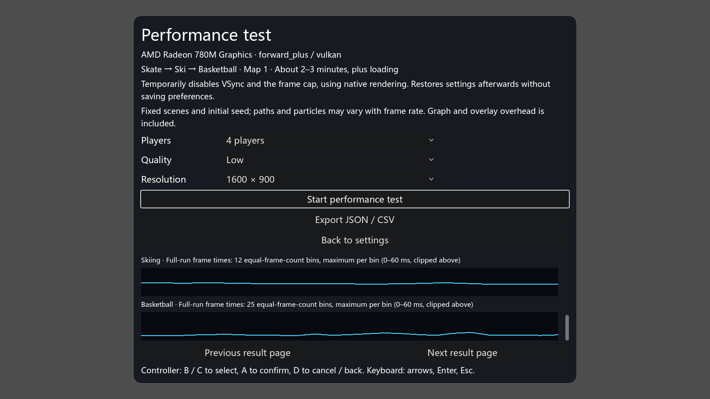

# 内置性能测试验收 — 2026-10-23

本报告记录功能验收，不是新的性能基线。正式 36 次基线见 [Radeon 780M 报告](baseline-Radeon780M-2026-10-23.md)。

## 已完成

- 主菜单“设置 → 性能测试”提供双/四人、画质和分辨率选项，真实滑板 → 滑雪 → 篮球场景序列，进度与取消、结果曲线、平均 FPS / 1% low / p95 / p99 / CPU process / 独立视口 GPU 读数及有效覆盖率。
- 结束、失败、取消恢复临时内存设置与实际窗口；测试机器人不写玩家纪录。显式导出的 JSON 包含原始样本和共享统计，CSV 按帧/视口展开。运行时代码不依赖 tools 或 game/tests。
- 官方 Godot 4.7.2，Vulkan，实际 Radeon 780M；1600×900 中英文双/四人短测截图已目视检查，控件在画面内，末页曲线可查看。
- 短窗口验收 7/7 PASS：无头统计单元用例、真实渲染 core 双/四人，以及菜单双/四人 × 中英文。菜单每场预热 0.1 秒、采样 0.3 秒、低画质，明确 baseline=false，不能据此宣称产品默认时长或帧率目标已通过。
- 验收包括成功、预热/采样取消、提前结束、连续清理、最大化起点恢复、12 个玩家文件及备份/临时副本哈希、JSON/CSV、导出失败、返回设置焦点与真实截图。引擎日志、着色器及已知 Vulkan 管线缓存不属于业务文件；退出后缓存曾导致的清单误报已精确区分。
- 正常生命周期六项目 × 双/四人 12/12 PASS；shell、存档恢复/重开、完整派对流程 PASS；所需启动检查 15/15 PASS。启动工具原有的资源保留退出警告仍明确显示，不能冒称该工具严格退出无警告；新 benchmark 验收不豁免引擎错误或泄漏。
- 工具测试 69 passed / 130 subtests，Hub 62 passed，Node 8 passed，Ruff 通过。规范 0 错误/3 个原有 SIZE 警告；i18n 433 文案，0 缺失/0 多余。

## 保留的未验证项

产品默认仍为每场 PLAY 预热 10 秒、采样 30 秒。已尝试高画质完整双人序列：第一场滑板完成 30 秒采样，切换滑雪时窗口条件不符，整段序列 FAIL；诊断重试明确记录窗口由 mode=0 变为 mode=1（最小化），尺寸仍为 1600×900，产生 0 个采样帧并正确拒绝。失败样本没有改写为成功。

用户随后要求稍后再跑完整序列、先提交现有成果。因此完整 10/30 秒双/四人序列仍待补测，四人完整序列未启动。不要把短测通过、单场滑板完成或正式基线中的独立仪器结果当作此项已验收。额外诊断只在开始/结束记录窗口快照，原窗口条件仍严格，没有增加宽限或忽略最小化。

更新后的共享 CLI 适配器尚未单独完成真实窗口启动验收；core 采样器本身已由上述双/四人用例验证。未验证真 BLE/手机手感、真实 HDR 输出、其他平台/硬件/地图和 4.8 对比。运行时未采集供电，字段为 null；完整尝试的外部端点供电记录在 summary 中。不同采样器/覆盖层开销及批次条件不能混成优化收益。

## 证据与复跑

- [验收原始 JSON/CSV、日志、图片及失败诊断 ZIP](ingame-benchmark-acceptance-2026-10-23.zip)，SHA-256：`20648cdadd08436ce239d5126052bc42aebf52cea59f41b62519b4eb832804ef`。manifest 逐文件列出 SHA-256；full-attempt 目录均为失败尝试，不是完整时长 PASS。
- 窗口诊断的可还原代码为 `90c23649495c160fd55963c1aa911fb4cc11078b`；初次完整尝试来源 `ea65c8cb4e01aa25c7ccb010268898816666db7e`。短测的生产代码与其相同，后续仅补窗口诊断字段；实际 source_commit=null 的短测元数据未伪造补写。
- 用户目录中的 benchmark 输出只在点击导出后写入；完整源码接口及统计规则见 [PERFORMANCE.md](../PERFORMANCE.md)。

```sh
python tools/test_benchmark.py --godot <GODOT_4_7_2_CONSOLE> --screenshots --players 2 4 --gpu-index <INDEX>
python tools/test_benchmark.py --godot <GODOT_4_7_2_CONSOLE> --full-duration --players 2 4 --gpu-index <INDEX>
```

复跑前接交流电源，并在全过程保持真实测试窗口可见、不最小化、不改大小。首次纹理、模型与管线加载另计；每场启动、采样和序列总等待均有上限。第二条是待完成的完整时长验收，不代表本报告已经跑通。

中文双人结果：



英文四人结果：



结果末页（真实短窗口曲线）：




