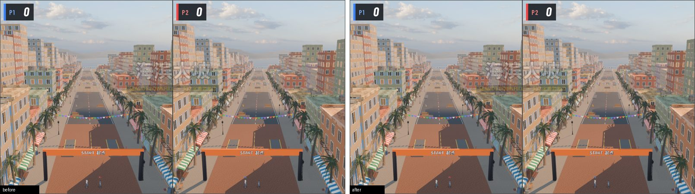
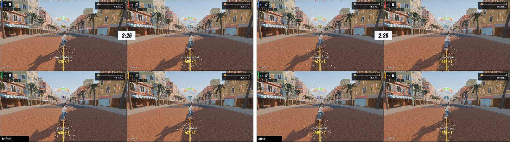
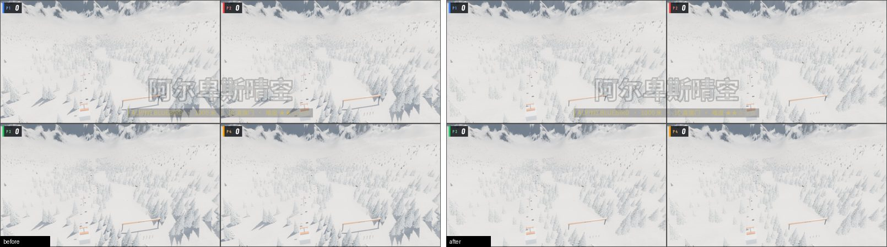
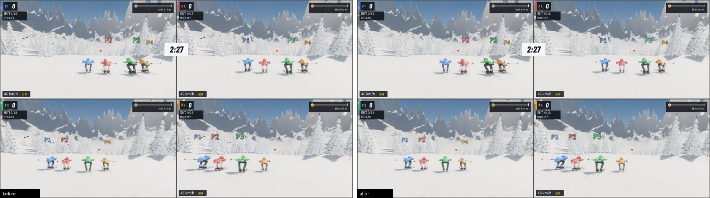

# #53 滑板 / 滑雪分屏性能 — 2026-10-25

本页是 #53 第 1.1、1.2、1.4 项的改动前后对照。每次运行的汇总统计在 `issue-53-2026-10-25-runs.csv`（逐帧原始数据不入库）。

## 测量条件

- 机器：RTX 4060 Laptop（默认设备，`--expect-gpu 4060` 校验），Godot 4.7.2 官方版，Vulkan / Forward+，供电 ONLINE。
- `tools/bench.py --resolution 2560x1440`（无边框铺满屏幕，见下文），高画质（2），原生分辨率，VSync 关，不限帧；预热 10 秒，采样 30 秒，种子 20261023。
- 全部在不可见桌面（`hidden_run.ps1`）上运行。每次运行前确认没有其他非 headless 的 Godot 进程（别的助手的 headless 测试只占少量 CPU，允许并存），运行中每 4 秒检查一次，出现其他渲染进程的结果作废重测（作废 1 次，不进统计）。最后一次（F 滑雪 4 人）只做了运行前检查。
- 三个版本按 A→B→F 交替各跑 **1 轮**（按维护者要求不跑多轮矩阵），所以单次数字有波动，尤其 1% low；平均 FPS 和每视口 GPU 时间的变化远大于波动。
  - **A**：改动前（当时的 dev + bench 分辨率提交）。
  - **B**：A + 1.1（固定步长子步、索引查找）+ 1.2（滑板分块），**不含** 1.4 阴影分屏档。
  - **F**：本 PR 全部改动（B + 1.4）。F 运行时工作区只有测试和 CI 文件未提交（`source_dirty=true`），游戏代码与提交一致。
- 所以 A→B 是 1.1+1.2 的效果，B→F 是 1.4 的效果（只在 3–4 个视图时生效）。1.1 单独的 CPU 效果另用无头计时测（见下）。

## 结果（RTX 4060 Laptop，2560×1440，高画质，各 1 次）

| 项目 | 人数 | 版本 | 平均 FPS | 1% low | p95 ms | 每视口 GPU 合计 ms | draw calls |
|---|---:|---|---:|---:|---:|---:|---:|
| 滑板 | 2 | A | 109.0 | 46.5 | 9.97 | 8.48 | 968 |
| 滑板 | 2 | B | 150.0 | 47.3 | 9.24 | 4.36 | 1596 |
| 滑板 | 2 | F | 150.8 | 56.2 | 8.74 | 4.36 | 1621 |
| 滑板 | 4 | A | **58.7** | 35.8 | 17.89 | 16.29 | 2169 |
| 滑板 | 4 | B | 71.8 | 27.4 | 18.59 | 7.28 | 3905 |
| 滑板 | 4 | F | **87.4** | 46.1 | 14.27 | 6.93 | 3046 |
| 滑雪 | 2 | A | 128.2 | 66.9 | 8.44 | 7.21 | 611 |
| 滑雪 | 2 | B | 127.5 | 61.1 | 8.52 | 7.23 | 612 |
| 滑雪 | 2 | F | 126.9 | 51.1 | 8.50 | 7.23 | 612 |
| 滑雪 | 4 | A | **72.8** | 29.6 | 16.18 | 12.62 | 1625 |
| 滑雪 | 4 | B | 74.1 | 33.7 | 15.05 | 12.69 | 1621 |
| 滑雪 | 4 | F | **80.5** | 31.1 | 14.74 | 11.41 | 1416 |

“每视口 GPU 合计”是各玩家视口 `gpu_viewports_ms` 之和的帧平均。要点：

- 滑板 4 人 58.7 → 87.4 FPS（+49%）；滑板 2 人 109 → 151 FPS（+38%）。改动前每个视口约 4 ms GPU，与视口像素无关（2 人格子比 4 人大一倍，时间几乎一样），说明成本在几何 / 阴影提交上；分块后每视口 GPU 时间减半（2 人 8.5 → 4.4 ms，4 人 16.3 → 7.3 ms）。分块使 draw calls 增加（每块单独提交），但每次提交的内容少得多，总体是净收益。
- 1.4 阴影档：滑板 4 人 71.8 → 87.4，滑雪 4 人 74.1 → 80.5，draw calls 和每视口 GPU 时间都下降；1–2 人不受影响（滑雪 2 人三版在波动范围内）。
- 1% low 只有 1 次运行，波动大（例如滑板 4 人 B 的 27.4），不作结论。

## 1.1 固定步长子步 + 索引查找

- 新增 `RSFixedStep`（`game/core/fixed_step.gd`）：帧时间进累加器，按 1/120 秒整步取出，每帧最多 3 步；需要更多步时改成 3 个较长的步（每步最长 1/40 秒），保持实时；只有超过 75 ms 的卡顿会丢掉多余时间。剩余不足一步的时间用上一步的位移外推绘制（`draw_pos`），不增加显示延迟；帧时间正好是整步时与原位置完全相同。相机和名字标签跟 `draw_pos`。
- 一帧没有子步时，控制器这一帧的转体量直接计入 `spin`，不会丢；滑板的转体分摊改成和滑雪一样按本帧子步数平分（原来按 `get_process_delta_time()` 计算）。
- `RSSkateCourse.H / road_slope` 改为二分查找剖面点；`surface / top` 只遍历该 s 所在 4 m 分桶里的 pieces（按原顺序，结果逐位相同）。
- `tools/test_perf.py`：在 6 万多个采样点（含所有剖面点、piece 边界及两侧 ±1 mm）上，新旧 `H / road_slope / surface / top` 全部相等；30–240 FPS 下每帧子步数 ≤ 3 且模拟时间跟上真实时间；真实滑手和滑雪者在 30 FPS 下每帧 ≤ 3 步并正常前进。
- 无头计时（临时脚本直接以固定帧长驱动 4 个机器人骑手，900 帧，±3% 帧长抖动，改动前后交替各两轮）：

| 项目 / 帧率 | 改动前（两轮） | 改动后（两轮） |
|---|---|---|
| 滑板 30 FPS | 1806 / 1773 µs | 900 / 979 µs |
| 滑板 60 FPS | 1185 / 1340 µs | 663 / 672 µs |
| 滑板 100 FPS | 1028 / 1127 µs | 588 / 578 µs |
| 滑雪 30 FPS | 1063 / 1298 µs | 1439 / 888 µs |
| 滑雪 60 FPS | 832 / 1002 µs | 1045 / 866 µs |
| 滑雪 100 FPS | 791 / 850 µs | 946 / 692 µs |

（每帧 4 名骑手 `step()` 的总耗时，含动画和特效更新。）滑板的骑手计算减半，主要来自索引查找（`surface()` 单次 18.9 → 2.3 µs，41 个 piece、12 个剖面点）。滑雪的子步本来就只查数组，耗时主要在每帧的绘制更新上，两轮差异来自机器人路线不同（摔倒等），属于噪声；它的收益是 30 FPS 及以下每帧子步从 4 降到 3，并且卡顿时不再成倍增加。

## 1.4 分屏阴影档

- `RSSettings.set_views(n, root)`：`RSPartyViews` 在布局和显隐变化时报告实际在画的视图数（大厅时视图隐藏，按 1 个算；离开场景复位为 1）。视图数 ≥ 3 时，原来 4 级级联的太阳改为 2 级级联，阴影距离 × 0.6，近级联占 25%；回到 1–2 个视图时恢复。场景原值存在 metadata 里，重复应用不累积，与 #79 的 `apply_world()`（切图后重新应用）兼容：切图后新建的太阳直接进入当前档位。原本不是 4 级级联的灯不动。
- 单元测试覆盖 1→2→3→4→2→1 切换、重复 `apply_world`、四视图时新建太阳、两级级联的灯不受影响。

## 1.2 滑板网格分块

- `RSSkateCourse` 所有静态网格（course、city、seafront、props、crowd_barriers）按 s 每 50 m 一块提交，节点名 `<名称>_<块号>`；每个四边形 / 附加网格按自身中心所在块归类，材质、几何、生成顺序和随机数消耗都不变。`RSProps.place` 的道具（路灯、棕榈、消防栓、空调、街道家具、礁石）也按 50 m 分组成多个 MultiMesh。
- 没有加 `visibility_range`：远处楼群是天际线的一部分，加了会出现跳变，截图也会变。分块后，超出阴影距离或视锥的块本来就不再进入对应的 pass，这就是“远处楼少画阴影”的来源。

## 截图对照

`--fixed-fps 60` 下同一时刻（`--at=1,6,12,20`）、1600×900，改动前 / 后逐像素比较。固定帧长下新旧子步完全一致，所以骑手位置相同。

| 截图 | 改动前后：均差 / 差异 >8 的像素 / >32 的像素 | 基线重跑（噪声） |
|---|---|---|
| 滑板 1 人 t=1/6/20 | 0.005–0.012 / ≤0.05% / ≤0.006% | 未重跑 |
| 滑板 1 人 t=12 | 0.14 / 0.28% / 0.19%（与 2 人 t=12 同一处粒子） | 未重跑 |
| 滑板 2 人 t=1/6/20 | 0.011–0.014 / ≤0.06% / ≤0.006% | 0 |
| 滑板 2 人 t=12 | 0.48 / 0.95% / 0.65% | 0.42 / 0.82% / 0.58% |
| 滑雪 2 人 t=1/6/12/20 | 0.01–0.23 / ≤0.42% / ≤0.23% | 0.02–0.26 / ≤0.47% / ≤0.25% |
| 滑板 4 人（阴影档） | 0.6–1.5 / 2.1–5.6% / 0.3–3.0% | — |
| 滑雪 4 人（阴影档） | 0.25–2.3 / 0.8–7.6% / 0.07–2.7% | — |

- 1/2 人：差异只在远处棕榈的少量像素（分块后 MultiMesh 的 LOD 按块距离选择，原来整张地图一个 MultiMesh，相机总在包围盒内，始终用最高 LOD）。滑板第 3 张（t=12）和滑雪全部，基线与自己重跑的差异同样大（粒子随机），属于噪声。
- 4 人：阴影档生效，近处阴影基本不变，远处阴影变短、变淡；滑雪开场高空俯瞰时树影明显减少（开场镜头离地高，大部分树超出缩短后的阴影距离）。对照图：

| 场景 | 改动前 / 后 |
|---|---|
| 滑板 2 人 t=1 |  |
| 滑板 4 人 t=12（阴影档） |  |
| 滑雪 4 人 t=1 开场（阴影档） |  |
| 滑雪 4 人 t=12（阴影档） |  |

## 其他发现

- 2560×1440 窗口下，分屏 SubViewport 的实际渲染尺寸是按 1600×900 画布算的（4 人每格 796×446，2 人每格 796×896，见 `metadata.window_end.viewport_sizes`），不是窗口像素，然后再放大到窗口。#53 里“已排除”的结论来自高尔夫测试场景，不适用于 `RSPartyViews`。这影响画质多于性能，本 PR 不改。
- `cpu_process_ms` 来自 `Performance.TIME_PROCESS`，Godot 每秒才更新一次，取的是这一秒内最慢一帧的处理时间（含绘制提交），不是每帧平均；它和帧时间对不上（可以大于帧时间）。所以 1.1 的 CPU 效果用上面的无头计时说明，表中的 `cpu_process_ms` 只作参考。

## 没有验证的

- 只测了 RTX 4060 Laptop；780M 核显未测。只测了滑板地图 0、滑雪地图 0、高画质。
- 真机手感（体感输入）、HDR 未测。1.3（角色 LOD）、1.7（粒子 / HUD / 音频小开销）未做。
